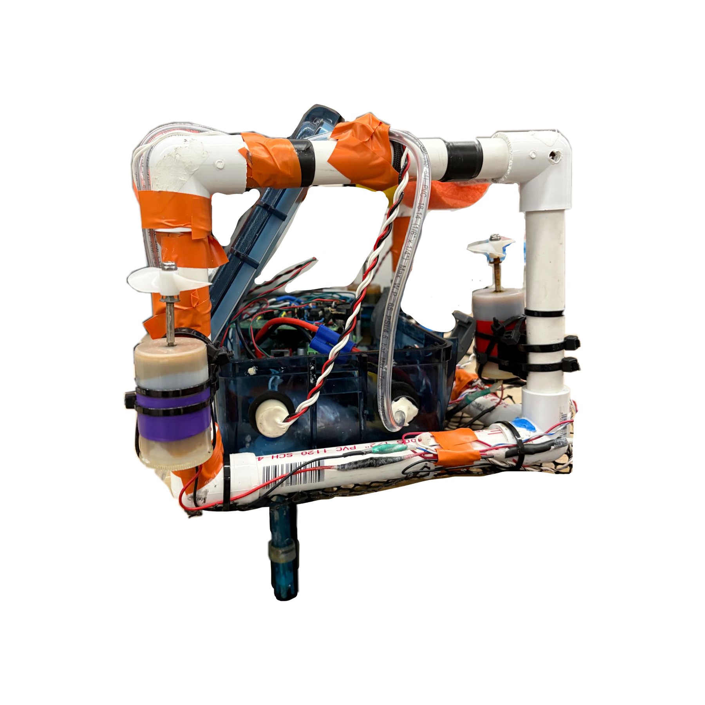
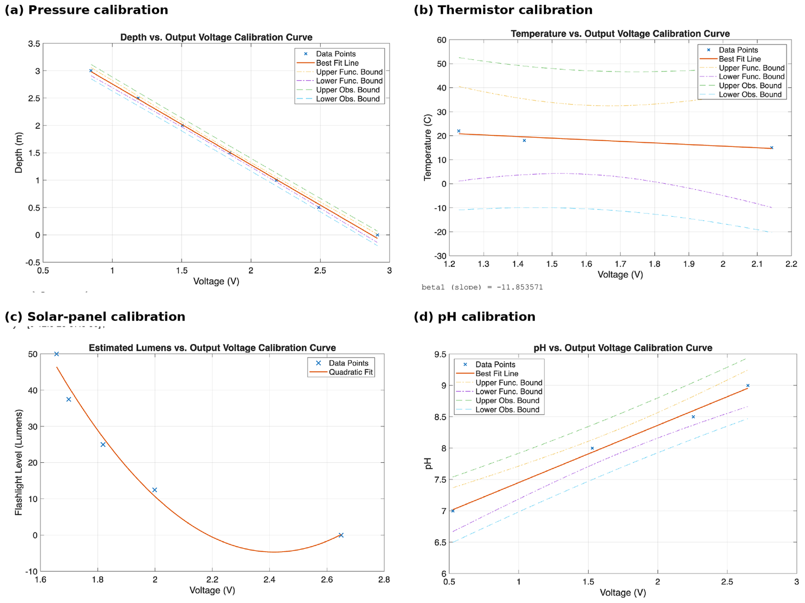
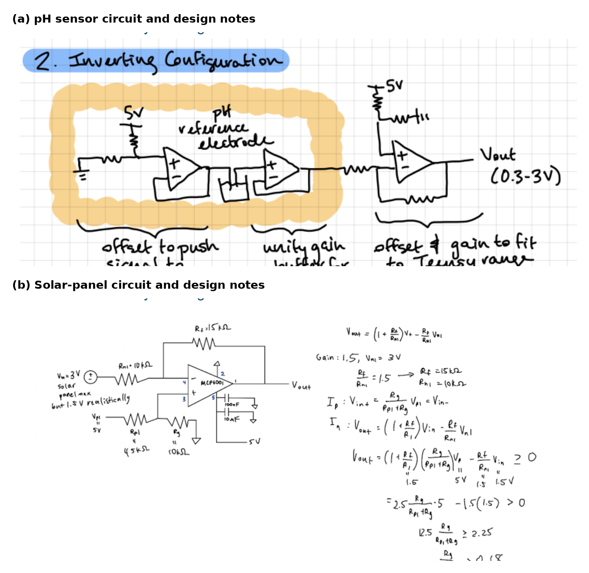
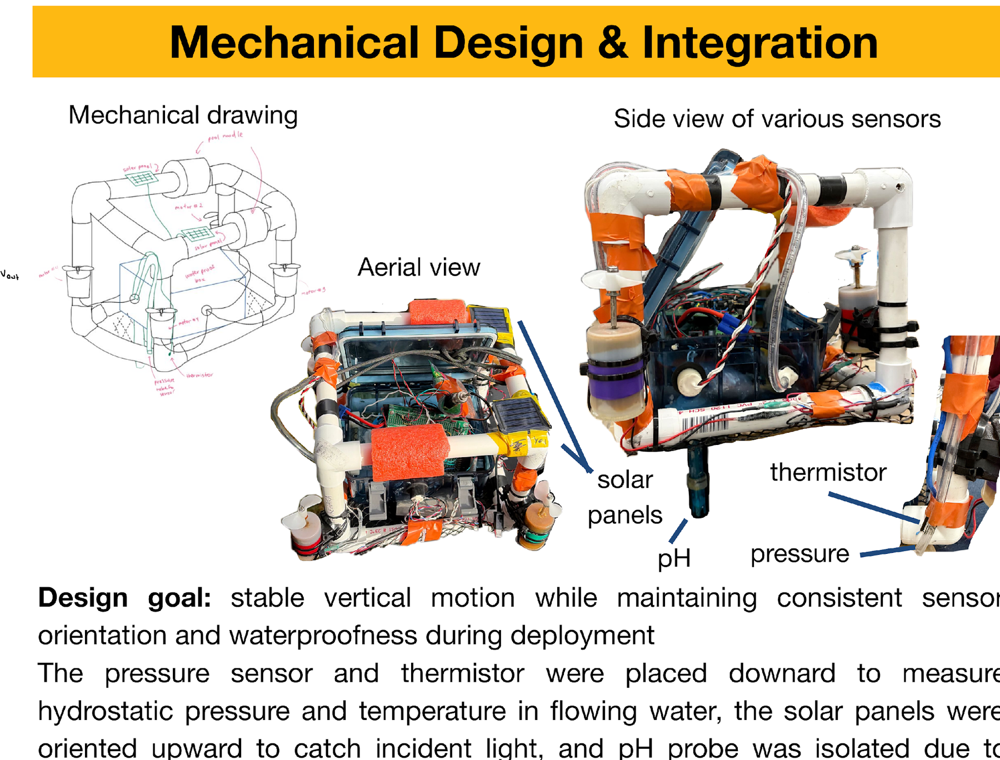
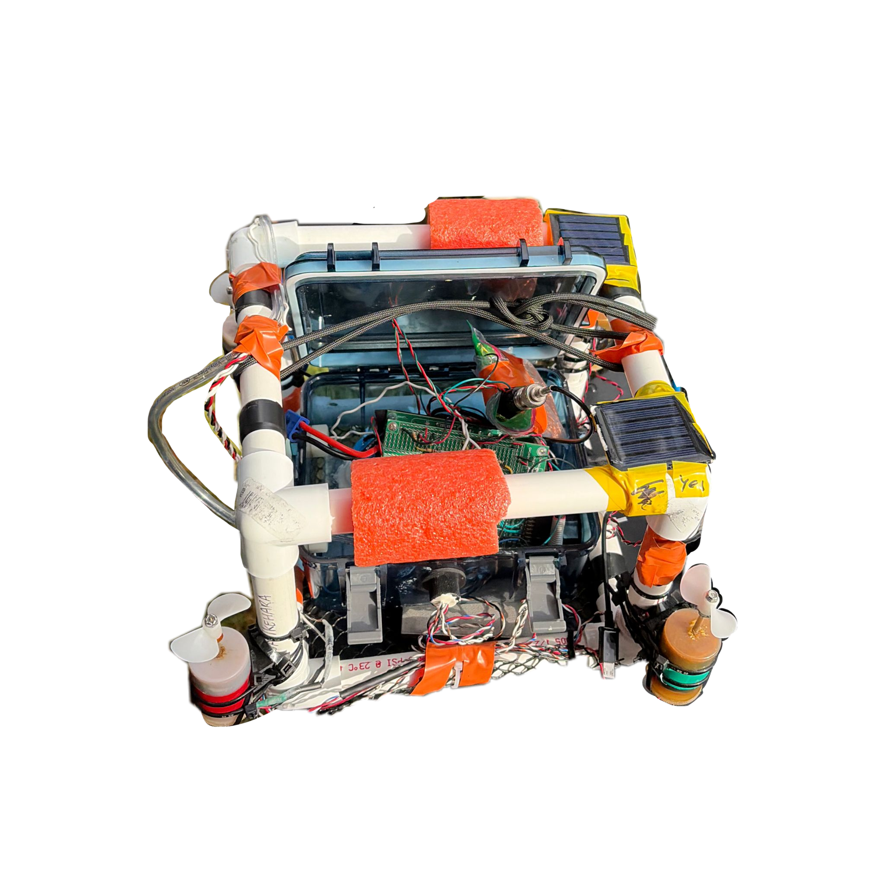
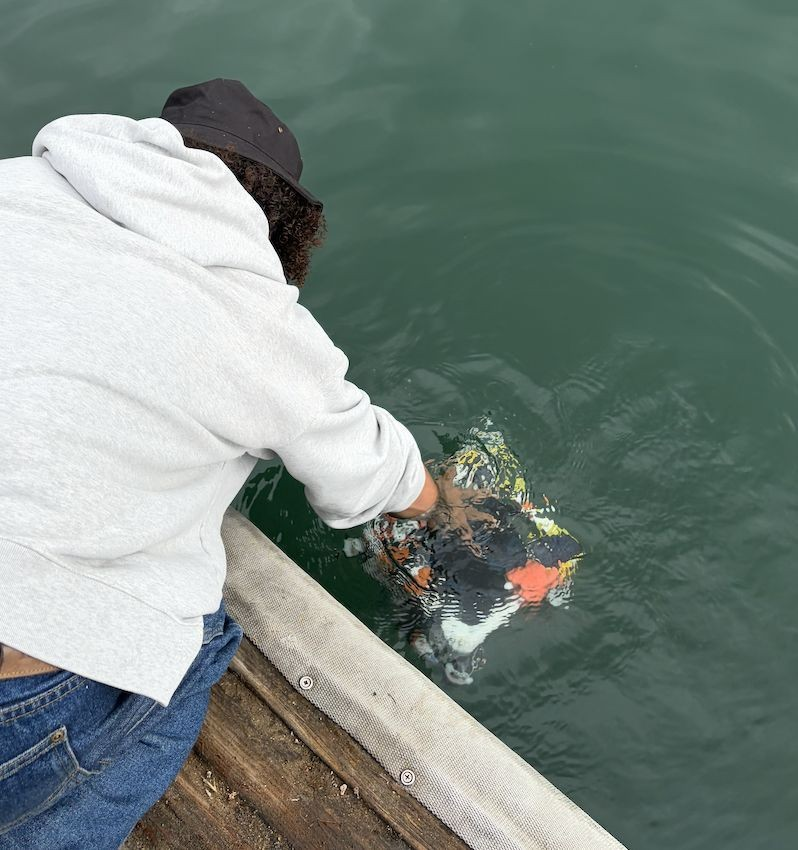
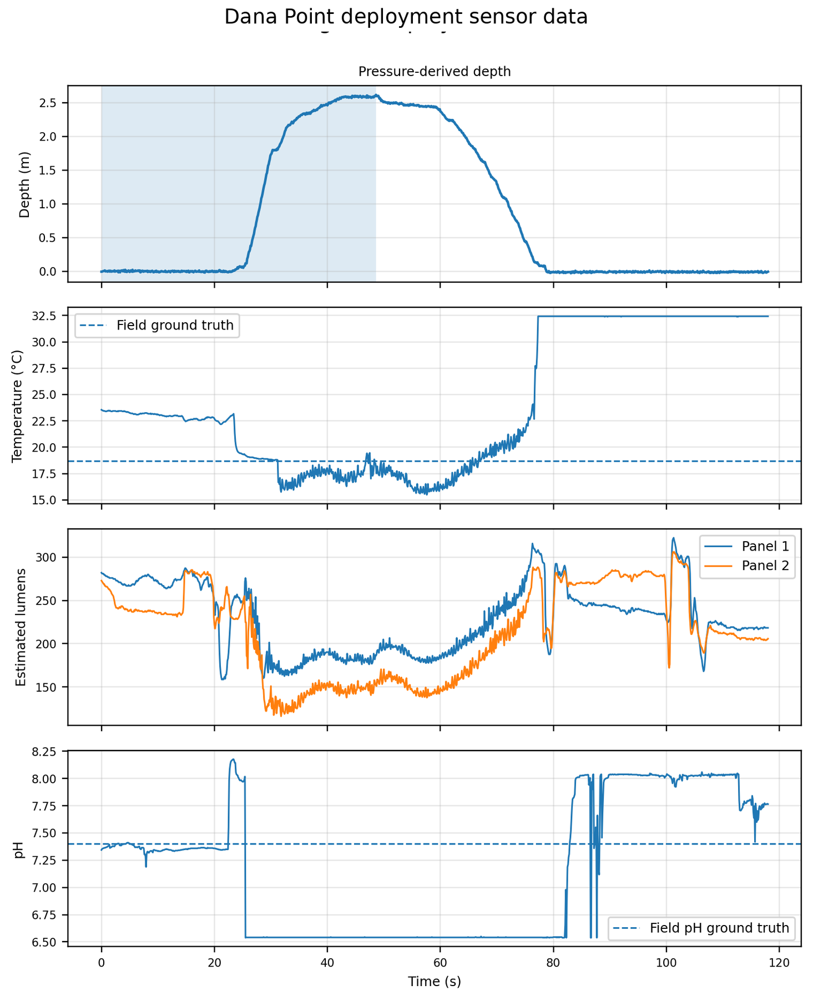
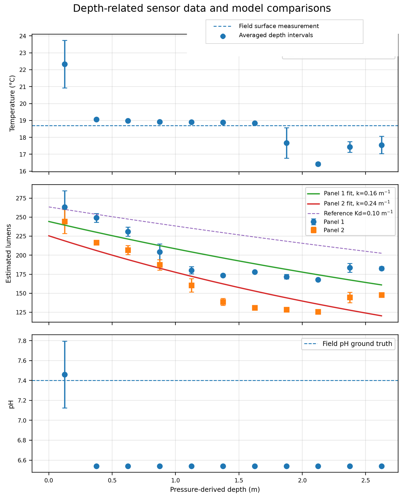

[← Back to all projects](projects.qmd)

```{=html}
<section class="project-overview" aria-label="Project overview">
  <div class="project-overview-media">
    
  </div>
  <div class="project-overview-body">
    <span class="tag">E80 · Experimental Engineering · Spring 2026</span>
    <p><strong>Overview</strong><br>
    Our four-person team designed, calibrated, and deployed a low-cost autonomous underwater vehicle that measured pressure, temperature, pH, and relative light intensity as a function of depth. The final field test at Dana Point produced a successful 2.61 m profile.</p>
    <p><strong>My focus</strong><br>
    Analog signal conditioning, sensor calibration, waterproof electrical integration, field debugging, and analysis of the depth-resolved dataset.</p>
    <p><strong>Skills</strong><br>
    Op-amp circuits, Teensy ADC acquisition, sensor calibration, MATLAB, waterproofing, mechanical integration, and field testing.</p>
    <div class="project-links">
      <a class="action action-primary" href="Images/E80 Final report.docx.pdf" target="_blank">Read Final Report</a>
      <a class="action action-outline" href="Images/E80_Poster.pptx.pdf" target="_blank">View Poster</a>
    </div>
  </div>
</section>
```

::: {.project-facts}
<div><span>Maximum depth</span><strong>2.61 ± 0.05 m</strong></div>
<div><span>Pressure residual</span><strong>0.0462 m RMS</strong></div>
<div><span>Temperature trend</span><strong>23.1 → 18.0 °C</strong></div>
<div><span>Light reduction</span><strong>30% and 38%</strong></div>
:::

## Mission

Water quality can change substantially within the first few meters below the surface, but collecting repeatable measurements at multiple depths usually requires specialized equipment. We set out to determine whether a small, low-cost AUV could gather useful environmental data during a controlled vertical dive.

The robot needed to carry four analog sensing channels, maintain a consistent sensor orientation, protect its electronics from salt water, and return recoverable data after deployment. The sensing budget was constrained to roughly $50, which motivated the use of inexpensive solar panels as relative light sensors and concentrated most of the budget on the pH probe.

## System architecture

Pressure served as the independent depth coordinate for every other measurement. Each analog sensor passed through a channel-specific conditioning circuit before reaching the Teensy ADC. The deployment log was then converted from ADC counts to voltage and from voltage to engineering units with empirical calibration equations.

```{mermaid}
flowchart LR
  P[MPX5700 pressure] --> CP[Offset + gain]
  T[47 kΩ thermistor] --> CT[Divider + buffer + offset]
  H[Glass pH electrode] --> CH[High-impedance interface + shielding]
  L[Two solar panels] --> CL[Attenuation + offset]
  CP --> ADC[Teensy ADC]
  CT --> ADC
  CH --> ADC
  CL --> ADC
  ADC --> LOG[Deployment log]
  LOG --> MATLAB[MATLAB calibration and analysis]
  MATLAB --> DEPTH[Depth-resolved profiles]
```

## Sensor and circuit design

The raw sensor outputs occupied only part of the Teensy's 0-3.3 V input range, so the analog front end used buffers, attenuation, offset, and gain stages to increase usable resolution while preventing overvoltage. A 12 V battery powered the robot, and an onboard regulator supplied a stable 5 V rail to the sensors and MCP601/MCP602 op-amps.

| Channel | Sensor and purpose | Conditioning and calibration |
|---|---|---|
| Depth | MPX5700 pressure sensor | Offset and gain mapped the expected 0-3 m signal into the ADC range; pool calibration produced `h = -1.4708V + 3.9236`. |
| Temperature | Murata 47 kΩ NTC thermistor | A divider and unity-gain buffer prevented loading before the offset stage; processing used `T = -11.854V + 32.424`. |
| pH | Glass-electrode interface module | A high-input-impedance path, added gain, and a grounded Faraday cage reduced noise; buffer calibration produced `pH = 0.912V + 6.538`. |
| Relative light | Two ZW-5050-3V solar panels | Attenuation protected the ADC from bright conditions; a quadratic calibration converted voltage to estimated lumens. |

{#fig-e80-calibration width=100% fig-align="center"}

{#fig-e80-circuits width=90% fig-align="center"}

The pH circuit required extra care because the glass electrode and its interface were sensitive to high source impedance, long leads, motor PWM, and nearby wiring. We placed that channel on a separate breadboard inside a grounded copper-and-aluminum Faraday cage. The shielding reduced electrical noise, but it could not correct the chemistry mismatch between freshwater buffer calibration and seawater deployment.

## Mechanical integration

{#fig-e80-mechanical width=100% fig-align="center"}

The PVC frame was designed primarily for vertical movement. The pressure sensor, thermistor, and pH probe faced downward so their sensing surfaces sampled approximately the same depth. The solar panels faced upward to receive incident light, and the electronics enclosure sat near the center of the frame. Buoyant components were placed above heavier components to provide passive restoring stability.

The estimated robot mass was **3.3701 kg**, while the calculated buoyant force was **39.43 N**. The center of buoyancy was estimated at 0.135 m above the bottom of the frame, slightly above the 0.116 m center of mass. That separation helped the vehicle return toward an upright orientation after small disturbances.

The original design used four vertical motors. Two motors drew excessive current and produced motherboard reliability problems, so the final configuration used two diagonal vertical thrusters. This reduced electrical load while preserving a balanced vertical force arrangement.

## Testing and field deployment

The robot progressed through pool calibration, freshwater integration testing, and final saltwater deployment. Roberts Pool provided a controlled 0-3 m reference for the pressure channel. A later test at pHake Lake exposed a major waterproofing failure: water entered the electronics enclosure, activated motor-controller warnings, and caused several sensor channels to rail or short.

That failure changed the Dana Point procedure. Cable penetrations were resealed with marine epoxy, the empty enclosure was leak-checked before reinstalling electronics, and the team adopted a staged-depth plan. A 10 m tether provided immediate recovery, and 0.5 m tape marks supplied a visual depth reference. Before each launch, the serial monitor was used to confirm plausible outputs from all four sensor channels.

::: {.image-pair}
{fig-alt="Top view of the autonomous underwater robot"}

{fig-alt="A team member retrieving the underwater robot with a tether"}
:::

The final dataset was recorded on **April 25, 2026**. Early complications reduced the planned 9 m profile to a safer 3 m target, allowing the team to collect a complete descend-hold-return dataset without risking the vehicle.

## Results

{#fig-e80-timeseries width=92% fig-align="center"}

{#fig-e80-depth-results width=92% fig-align="center"}

::: {.result-grid}
::: {.result-card}
### Pressure

The pressure channel was the strongest quantitative result. It captured the complete descend-hold-return motion and measured a maximum depth of **2.61 ± 0.05 m**. Its pool-calibration RMS residual was only **0.0462 m**.
:::

::: {.result-card}
### Temperature

The thermistor decreased from **23.1 ± 0.3 °C** before immersion to **18.0 ± 0.6 °C** at the deepest interval. A field thermometer measured 18.7 °C at the surface, so the channel demonstrated a useful relative trend but retained an absolute offset.
:::

::: {.result-card}
### Relative light

The two solar-panel channels fell by approximately **30 ± 3%** and **38 ± 6%**. Exponential fits yielded attenuation coefficients of 0.16 ± 0.08 m⁻¹ and 0.24 ± 0.11 m⁻¹, although tilt, waves, shadowing, and broadband response limit quantitative interpretation.
:::

::: {.result-card}
### pH

The pH output converged near **6.54**, while field ground truth was approximately **7.4**. The nearly constant, clipped response was excluded as environmental data and treated as evidence that the probe required seawater-specific calibration and longer settling time.
:::
:::

## What the failures taught us

The project produced useful data because failures were treated as design information rather than hidden from the final analysis.

- **Waterproofing must be verified before electronics are installed.** The pHake Lake flood led to separate enclosure testing, cleaner penetrator holes, marine epoxy sealing, and immediate tethered recovery.
- **Calibration must match the deployment environment.** Low-salinity pH buffers did not reproduce the liquid-junction behavior of the glass electrode in seawater.
- **Relative and absolute accuracy are different.** The thermistor clearly followed a cooling trend, but its offset against the field thermometer prevented a strong absolute-temperature claim.
- **The sensor can disturb the measurement.** Solar-panel orientation, robot tilt, surface ripples, and frame shadows all affected the apparent light profile.
- **One successful dive is not enough for repeatability.** Future deployments should use repeated descents with 20-30 second holds at fixed depths to separate real water-column structure from sensor lag and vehicle motion.

## Team and next iteration

This was a team project with **Luke Pratt, Megan Tran, and Lucy Will**. The next version should use seawater-matched pH standards, sealed modular gain settings, improved high-impedance shielding, and repeated fixed-depth profiles. The tether, staged-depth testing, and serial-monitor preflight checks should remain because they made field failures recoverable.

```{=html}
<div class="project-links project-links-bottom">
  <a class="action action-primary" href="Images/E80 Final report.docx.pdf" target="_blank">Read Final Report</a>
  <a class="action action-outline" href="Images/E80_Poster.pptx.pdf" target="_blank">View Project Poster</a>
</div>
```
