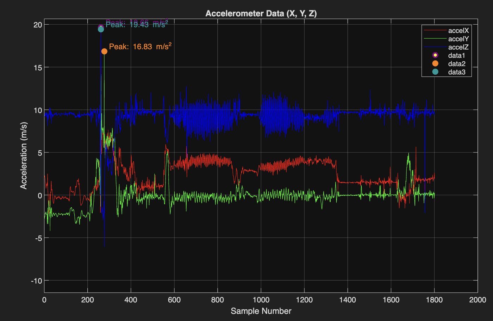
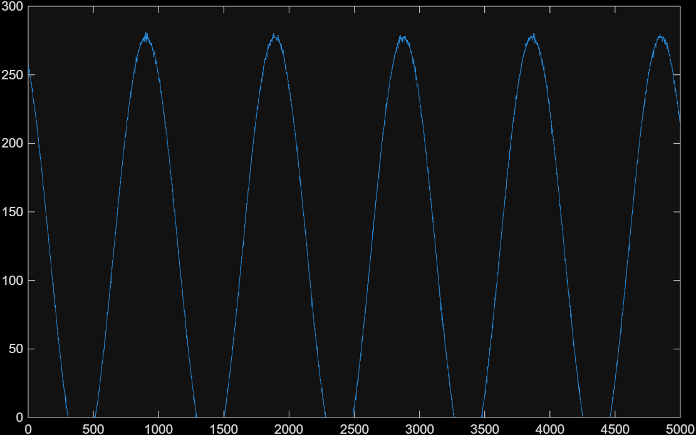
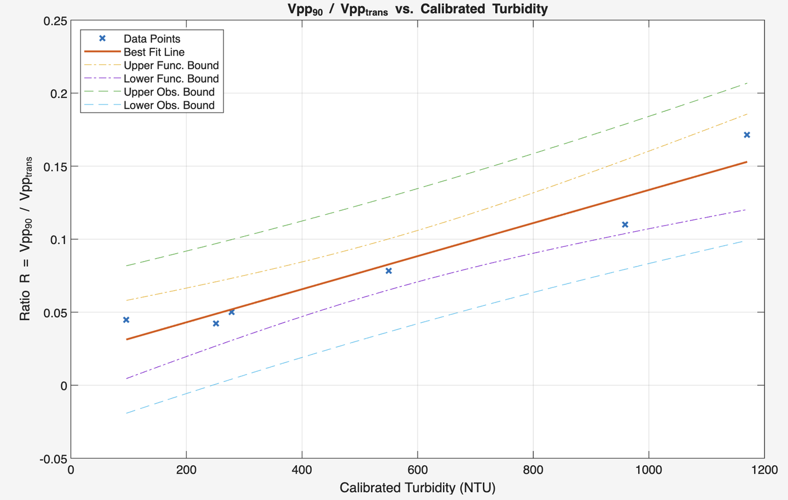
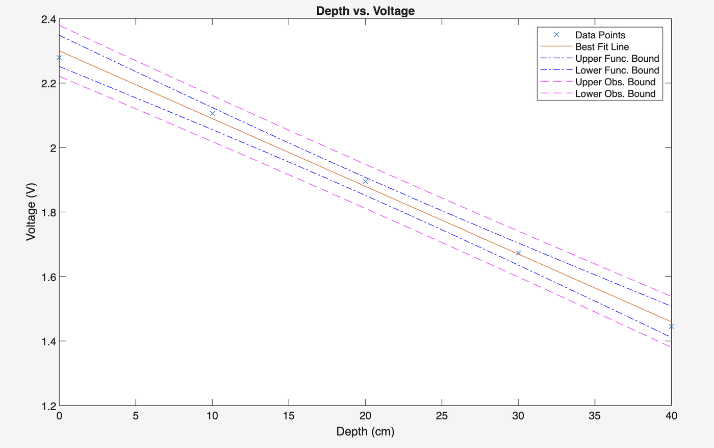
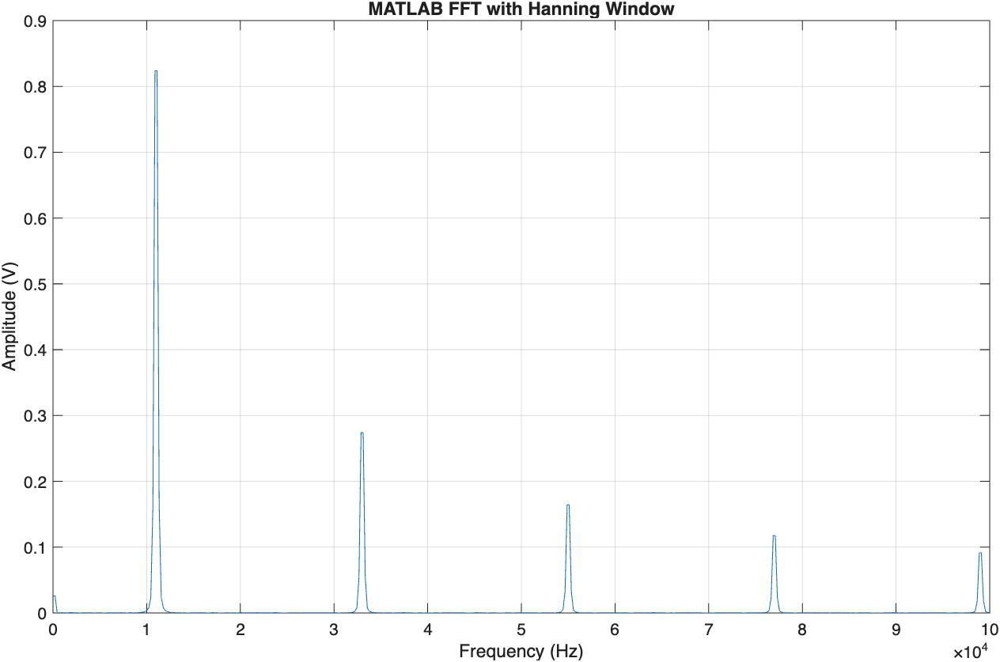
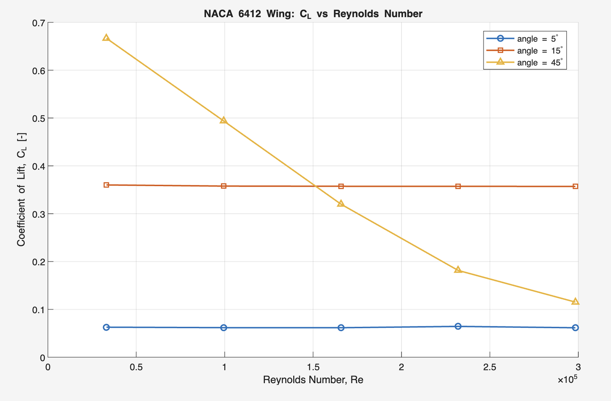
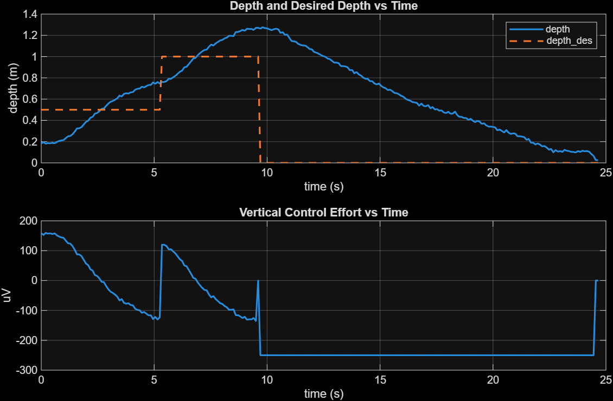

These reports summarize my E80 lab work at Harvey Mudd College: circuit design, calibration, statistics, and analysis that led up to our autonomous underwater robot. Labs 2–4 were done in pairs and the rest as a team of four.

```{=html}
<div class="card-grid">
  <a class="work-card" href="e80labs/lab1/lab1.html"><div class="thumb thumb-contain"></div><div class="card-body"><span class="tag">Lab 01 · IMU + autonomy</span><h3>Go Autonomous</h3><p>IMU calibration and statistics, plus an open-loop motor sequence through the tank obstacle course.</p></div></a>
  <a class="work-card" href="e80labs/lab2/lab2.html"><div class="thumb thumb-contain"></div><div class="card-body"><span class="tag">Lab 02 · Measurement</span><h3>Basic Electrical Measurements</h3><p>Teensy ADC calibration, instrument loading models, error propagation, and op-amp buffers.</p></div></a>
  <a class="work-card" href="e80labs/lab3/lab3.html"><div class="thumb thumb-contain"></div><div class="card-body"><span class="tag">Lab 03 · Op-amps</span><h3>Op-Amps and Marine Sensors</h3><p>Offset and transimpedance amplifiers plus a 555 LED driver, combined into a calibrated turbidity meter.</p></div></a>
  <a class="work-card" href="e80labs/lab4/lab4.html"><div class="thumb thumb-contain"></div><div class="card-body"><span class="tag">Lab 04 · Sensors</span><h3>Temperature and Pressure Sensors</h3><p>Pressure interface design, a Steinhart–Hart thermistor fit, thermocouple decoding, and settling times.</p></div></a>
  <a class="work-card" href="e80labs/lab5/lab5.html"><div class="thumb thumb-contain"></div><div class="card-body"><span class="tag">Lab 05 · Acoustics + FFT</span><h3>Underwater Acoustics</h3><p>FFTs and windowing, a two-stage microphone amplifier, beacon localization, and aliasing.</p></div></a>
  <a class="work-card" href="e80labs/lab6/lab6.html"><div class="thumb thumb-contain"></div><div class="card-body"><span class="tag">Lab 06 · Fluids + CFD</span><h3>Fluid Dynamics</h3><p>Wind-tunnel drag and lift, COMSOL simulations, and similitude for a scale robot model.</p></div></a>
  <a class="work-card" href="e80labs/lab7/lab7.html"><div class="thumb thumb-contain"></div><div class="card-body"><span class="tag">Project jump start · Control</span><h3>Navigation and Depth Control</h3><p>IMU dead-reckoning limits, pressure-to-depth calibration, and P-control for an autonomous dive.</p></div></a>
</div>
```

## Final Project

These labs built up to our [autonomous underwater robot](autonomous-underwater-robot.qmd). It measured pressure, temperature, pH, and light against depth, with a successful 2.61 m dive at Dana Point.
