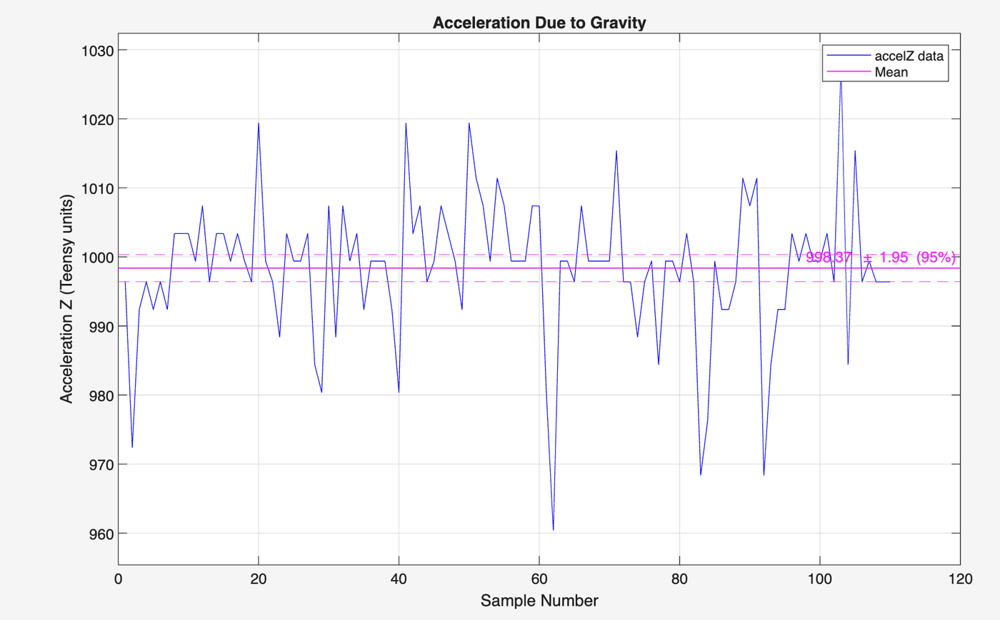
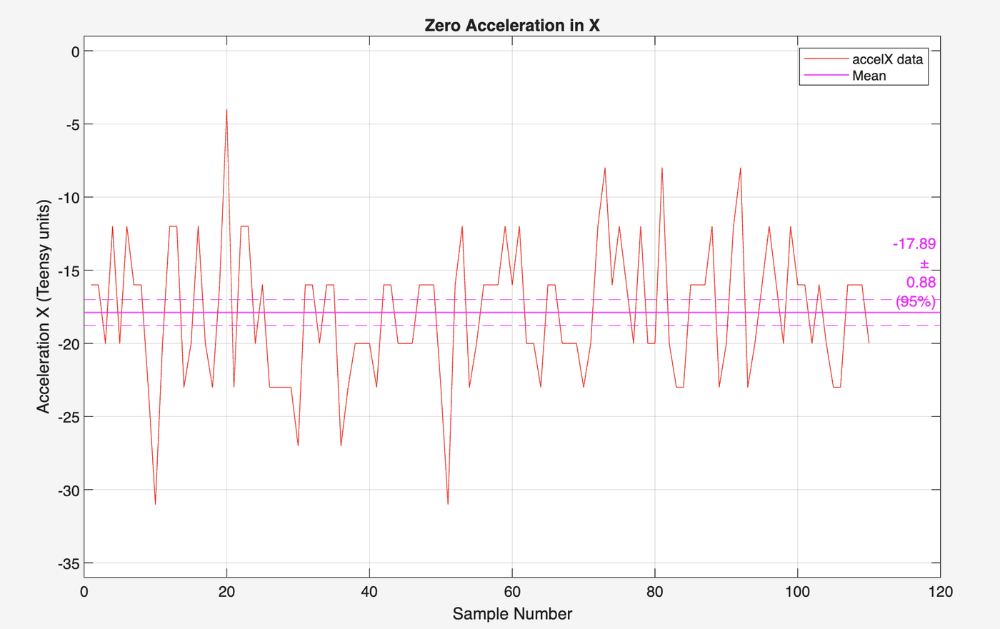
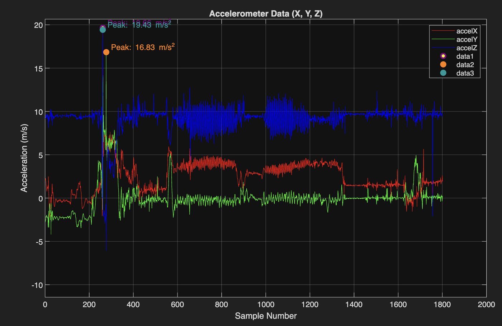

[← All E80 labs](../../e80.qmd)

## Overview

Our team of four converted an E79 remotely operated vehicle into an autonomous underwater vehicle (AUV). We assembled the Teensy motherboard, calibrated its IMU, and programmed a timed, open-loop motor sequence to carry the robot through the test-tank obstacle course.

**Result:** The robot completed the dive–forward–surface sequence on its own. Static IMU data gave a calibration of **one accelerometer unit ≈ 0.0098 m/s²**, and the logged run shows each phase of the course.

**Team:** Team 46 (four members) · [Course lab spec](https://hmc-e80.github.io/labs/lab1)

## IMU Calibration

With the board at rest, the z-axis reads gravity. Dividing $g$ by the mean z reading gives the scale factor:

$$
\frac{9.81\ \text{m/s}^2}{997.78\ \text{units}} \approx 0.0098\ \frac{\text{m/s}^2}{\text{unit}}
$$

{#fig-gravity width=90% fig-align="center"}

### Zero-acceleration offsets

Each axis was logged while level and at rest. The 95% bounds use $\lambda = t \cdot S_{\bar{x}}$ with $S_{\bar{x}} = S/\sqrt{N}$.

| Measurement | Mean (Teensy units) | 95% bound |
|---|---:|---:|
| x at rest | −17.89 | ±0.88 |
| y at rest | −26.19 | ±0.79 |
| z at rest | −2.39 | ±1.84 |
| z under gravity | 998.37 | ±1.95 |

For the gravity case, the standard deviation was 10.32 units and the standard error 0.984 units. Two-sample t-tests (`ttest2`) showed all three zero offsets are statistically different. For x vs. y, $p = 1.91 \times 10^{-36}$, and the other two pairs gave $p$ values that MATLAB rounded to zero. Each axis therefore needs its own offset correction.

{#fig-zerox width=80% fig-align="center"}

## Open-Loop Navigation

The robot waits 60 s after power-on so it can be placed in the tank, then runs a timed thrust sequence.

| Time window | Motors | Motion |
|---|---|---|
| 0–60 s | off | Placement delay |
| 60–65 s | C = −255 | Dive about 2 ft |
| 65–70 s | A = 255, B = −255 | Drive forward about 6 ft |
| 70–74 s | C = 255 | Surface through the final hoop |
| > 74 s | off | Stop |

<details>
<summary>Show obstacle-course motor sequence</summary>

```cpp
if (currentTime < 60000) {          // placement delay
  motorDriver.drive(0, 0, 0);
} else if (currentTime < 65000) {   // dive (vertical thruster)
  motorDriver.drive(0, 0, -255);
} else if (currentTime < 70000) {   // forward (horizontal thrusters)
  motorDriver.drive(255, -255, 0);
} else if (currentTime < 74000) {   // surface
  motorDriver.drive(0, 0, 255);
} else {
  motorDriver.drive(0, 0, 0);
}
```

</details>

## Results

{#fig-course width=100% fig-align="center"}

| Axis | Peak acceleration |
|---|---:|
| x | 19.66 m/s² |
| y | 16.83 m/s² |
| z | 19.43 m/s² |

### Theory vs. measurement

From the E79 drag model, acceleration is greatest at rest, where drag is zero, so $a_{peak} = F_{thrust}/m$. At full PWM, the E79 thrust fit gives $|F| = 0.6378$ N. With a robot mass of 3.31 kg:

$$
a_{peak} = \frac{0.6378\ \text{N}}{3.3101\ \text{kg}} \approx 0.193\ \text{m/s}^2
$$

The measured z excursion was about 9.5 m/s² above gravity, far larger than the prediction. The constant-thrust model ignores motor start-up transients, and the motherboard was not guaranteed to stay level in the waterproof box. Impacts and tilt therefore project gravity and shocks onto the logged axes.

## Takeaways

- Calibrate each IMU axis on its own; the zero offsets are statistically distinct.
- Spikes in raw accelerometer data come from tilt and impacts, so they are not a reliable measure of thrust.
- Open-loop timing is enough for a simple course, but it gives no feedback on where the robot actually is.

## References

- [E80 Lab 1 specification](https://hmc-e80.github.io/labs/lab1)
- [E80 source code](https://github.com/HMC-E80/E80)
