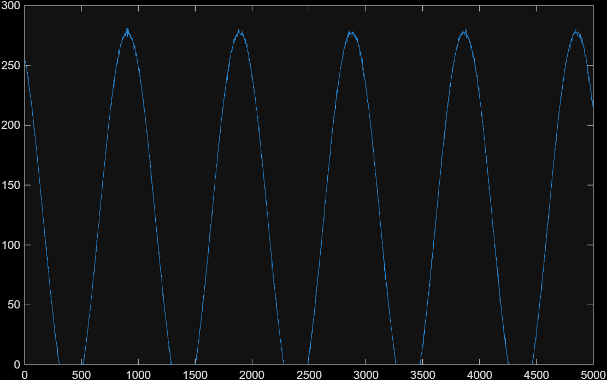
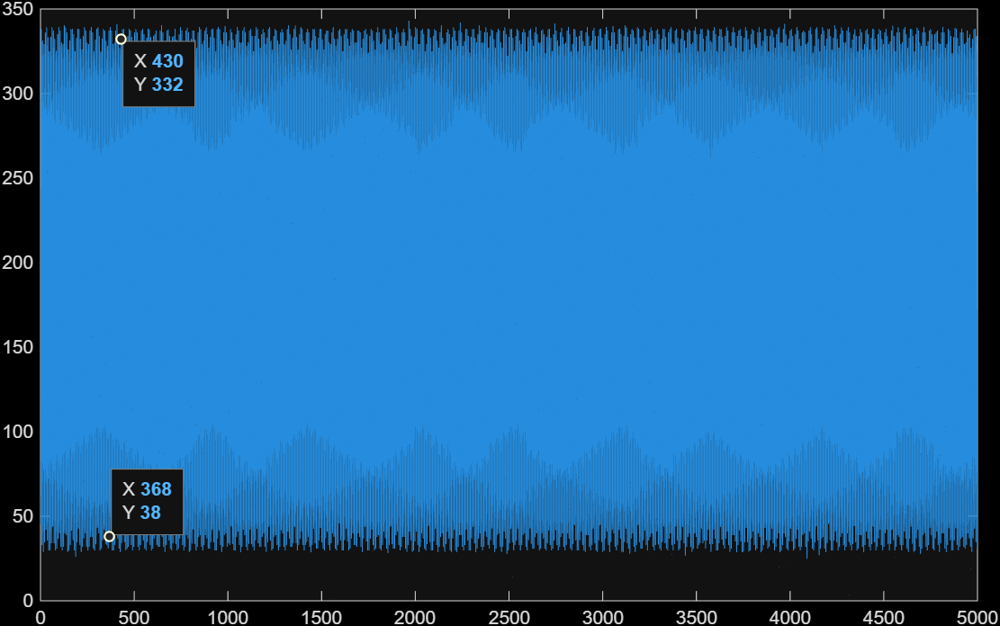
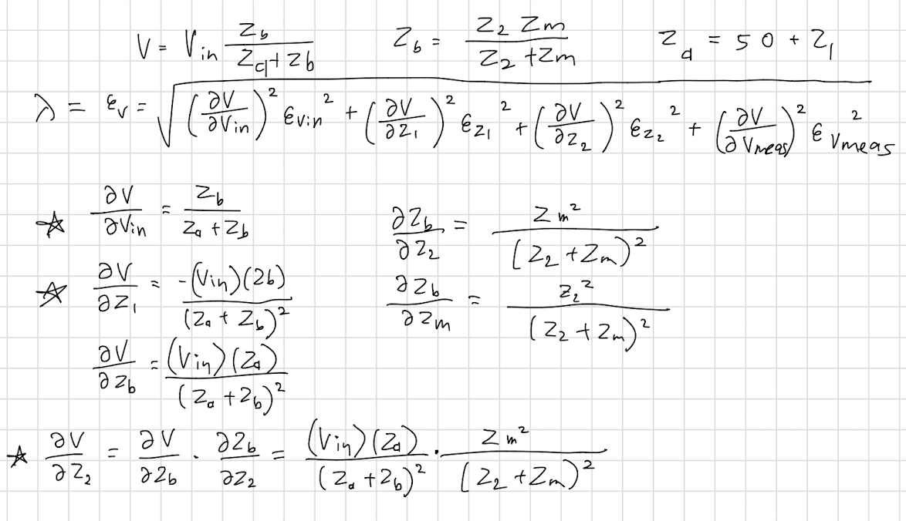

[← All E80 labs](../../e80.qmd)

## Overview

We characterized the Teensy's analog input, then measured resistor dividers with a multimeter, oscilloscope probes, and the Teensy. Each instrument's input impedance was modeled so we could predict how much it loads the circuit, and each prediction carried propagated uncertainty bounds. Finally, we used op-amp buffers to remove the loading.

**Result:** One Teensy unit is about **3.2 mV**, and the logger samples at roughly **200 kS/s**. Loading-aware predictions matched the measurements within their 95% bounds in 13 of 15 cases. Both op-amp buffer cases also agreed within their bounds.

**Team:** Ben Phung and Luke Pratt · [Course lab spec](https://hmc-e80.github.io/labs/lab2)

## Teensy ADC Characterization

### Voltage per Teensy unit

The function generator supplied a 200 Hz, 1 Vpp sine with a 0.4 V offset, so the input swings from −0.1 V to 0.9 V. The Teensy cannot read negative voltages and clips them to zero. The 0.9 V peak read as about 277 units:

$$
\frac{0.9\ \text{V}}{277\ \text{units}} \approx 3.2\ \text{mV per unit}
$$

{#fig-200hz width=90% fig-align="center"}

### Sample rate and aliasing

The 5000 samples spanned five 200 Hz periods, which is 1000 samples per 5 ms period:

$$
f_s = N \cdot f = 1000 \times 200\ \text{Hz} = 200\ \text{kS/s}
$$

A 175 kHz input is above the Nyquist limit ($f_s/2 = 100$ kHz), so the sampled waveform aliases into an unreadable envelope.

{#fig-175khz width=90% fig-align="center"}

## Voltage Dividers and Instrument Loading

Each measurement device was modeled as an impedance $Z_m$ in parallel with the bottom resistor, and the function generator's 50 Ω output in series with the top resistor:

$$
Z_a = Z_1 + 50\ \Omega, \qquad Z_b = \frac{Z_2 Z_m}{Z_2 + Z_m}, \qquad V_{out} = V_{in}\frac{Z_b}{Z_a + Z_b}
$$

Uncertainty bounds came from the root-sum-square of the partial derivatives, using 5% resistors, the 2% generator amplitude, and the instrument's datasheet accuracy.

{#fig-errprop width=90% fig-align="center"}

| $Z_1$ | $Z_2$ | Instrument | Predicted (Vrms) | Measured (Vrms) | Within 95%? | Error |
|---:|---:|---|---:|---:|:---:|---:|
| 10 Ω | 20 Ω | Multimeter | 0.0884 | 0.085 | ✓ | −3.8% |
| 10 Ω | 20 Ω | Teensy | 0.0884 | 0.099 | ✗ | 12.0% |
| 1 kΩ | 2 kΩ | Multimeter | 0.2318 | 0.232 | ✓ | 0.1% |
| 100 kΩ | 200 kΩ | 1× scope probe | 0.2209 | 0.210 | ✓ | −4.9% |
| 10 MΩ | 20 MΩ | Multimeter | 0.2333 | 0.231 | ✓ | −1.0% |
| 10 MΩ | 20 MΩ | 10× scope probe | 0.2333 | 0.234 | ✓ | 0.3% |
| 10 MΩ | 20 MΩ | Teensy | 0.2347 | 0.689 | ✗ | 194% |

Show all 15 divider measurements

| $Z_1$ | $Z_2$ | Instrument | Predicted (Vrms) | Measured (Vrms) | Within 95%? | Error |
|---:|---:|---|---:|---:|:---:|---:|
| 0 | open | Multimeter | 0.3536 | 0.352 | ✓ | −0.4% |
| 0 | open | 1× scope probe | 0.3535 | 0.3606 | ✓ | 2.0% |
| 0 | open | 10× scope probe | 0.3536 | 0.3553 | ✓ | 0.5% |
| 0 | open | Teensy | 0.3536 | 0.3724 | ✓ | 5.3% |
| 10 Ω | 20 Ω | Multimeter | 0.0884 | 0.085 | ✓ | −3.8% |
| 10 Ω | 20 Ω | Teensy | 0.0884 | 0.099 | ✗ | 12.0% |
| 1 kΩ | 2 kΩ | Multimeter | 0.2318 | 0.232 | ✓ | 0.1% |
| 1 kΩ | 2 kΩ | Teensy | 0.2318 | 0.240 | ✓ | 3.5% |
| 100 kΩ | 200 kΩ | Multimeter | 0.2341 | 0.231 | ✓ | −1.3% |
| 100 kΩ | 200 kΩ | 1× scope probe | 0.2209 | 0.210 | ✓ | −4.9% |
| 100 kΩ | 200 kΩ | Teensy | 0.2357 | 0.250 | ✓ | 6.1% |
| 10 MΩ | 20 MΩ | Multimeter | 0.2333 | 0.231 | ✓ | −1.0% |
| 10 MΩ | 20 MΩ | 1× scope probe | 0.2357 | 0.2323 | ✓ | −1.5% |
| 10 MΩ | 20 MΩ | 10× scope probe | 0.2333 | 0.234 | ✓ | 0.3% |
| 10 MΩ | 20 MΩ | Teensy | 0.2347 | 0.689 | ✗ | 194% |

The megaohm divider measured with the Teensy failed badly. Its source impedance is too high for the ADC input, so the Teensy could not get an accurate reading.

## Op-Amp Buffers

An op-amp has very high input impedance and very low output impedance. A buffer at the input isolates the source; a buffer at the output lets an instrument read the divider without drawing current from it.

| Buffer location | Predicted (Vrms) | Bound λ (V) | Measured (Vrms) | Within 95%? | Error |
|---|---:|---:|---:|:---:|---:|
| Input | 0.2357 | ±0.0040 | 0.231 | ✓ | 1.6% |
| Output | 0.2357 | ±0.0076 | 0.233 | ✓ | 1.1% |

## Takeaways

- Every instrument is part of the circuit; its input impedance must be in the model.
- The Teensy ADC clips negative inputs and aliases signals above $f_s/2$, so the analog front end has to offset and band-limit signals first.
- A unity-gain buffer is the simplest fix for loading a high-impedance source.

## References

- [E80 Lab 2 specification](https://hmc-e80.github.io/labs/lab2)
