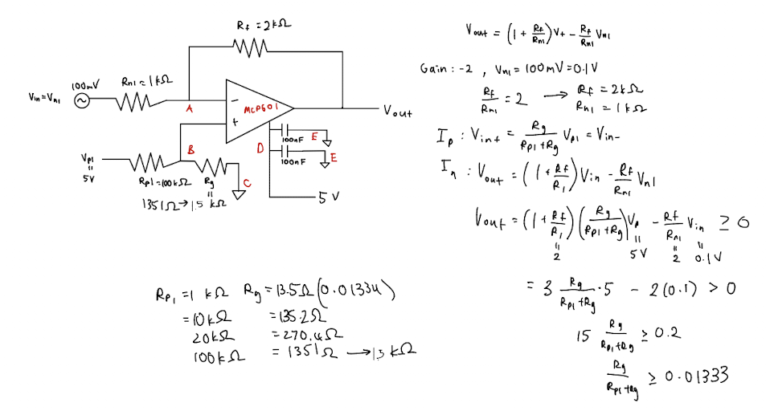
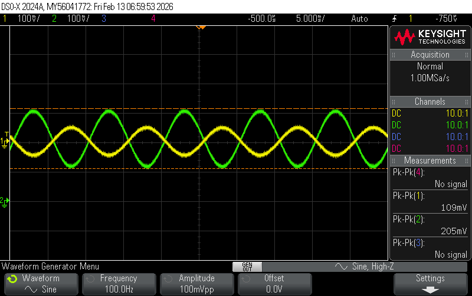
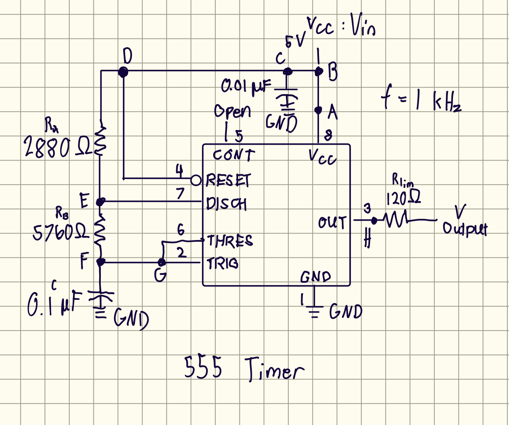
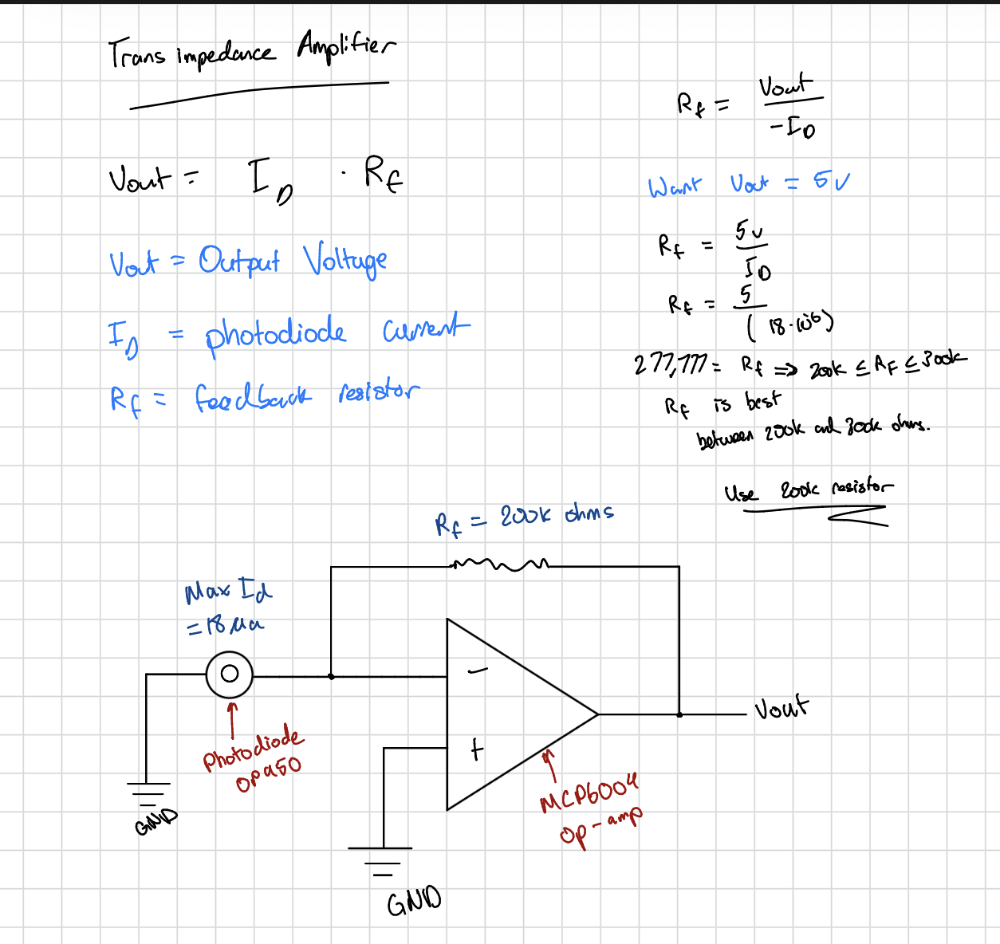
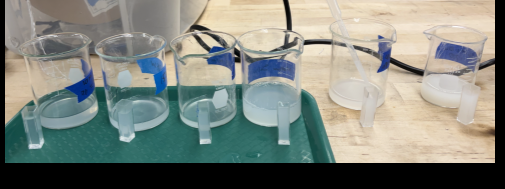
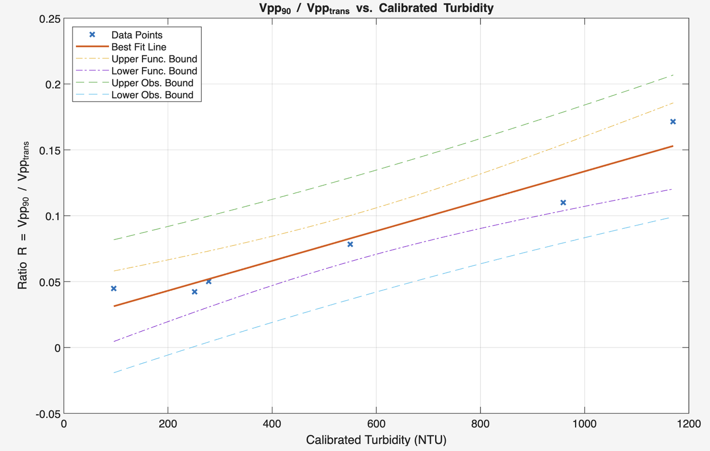

[← All E80 labs](../../e80.qmd)

## Overview

We built the stages of a turbidity meter, a sensor that measures how cloudy water is. The stages are a single-supply offset amplifier, a 555-timer IR LED driver, and transimpedance amplifiers that turn photodiode current into voltage. We then calibrated the meter against six reference solutions.

**Result:** The ratio of 90° scattered light to transmitted light rose linearly with turbidity from 96 to 1170 NTU, so the meter's output can be used to predict turbidity.

**Team:** Ben Phung and Megan Tran · [Course lab spec](https://hmc-e80.github.io/labs/lab3)

## Offset Amplifier

On a single 0–5 V supply, a non-inverting amplifier clips the negative half of a 0 V-offset input at ground. An offset amplifier adds a DC shift through the non-inverting input so the whole waveform stays above 0 V.

$$
V_{out} = \left(1 + \frac{R_f}{R_{n1}}\right)\frac{R_g}{R_{p1} + R_g}V_{p1} - \frac{R_f}{R_{n1}}V_{n1}
$$

For a gain of −2, $R_f = 2$ kΩ and $R_{n1} = 1$ kΩ. Requiring $V_{out} \ge 0$ for a 100 mV input gives $R_g/(R_{p1}+R_g) \ge 0.0133$. With $R_{p1} = 100$ kΩ, this sets $R_g \approx 1.5$ kΩ.

{#fig-offset width=100% fig-align="center"}

{#fig-offset-trace width=85% fig-align="center"}

## 555 Timer LED Driver

The IR LED is switched at 1 kHz with a 60% duty cycle, using $C = 0.1$ µF:

$$
R_A + 2R_B = \frac{1.44}{f C} = 14{,}400\ \Omega, \qquad \frac{R_A + R_B}{R_A + 2R_B} = 0.6
$$

Solving gives $R_B = 5760$ Ω and $R_A = 2880$ Ω. From the datasheet, the IR LED has a forward voltage of 1.2 V at 20–40 mA, so we added a series resistor to limit its current to that range.

{#fig-555 width=75% fig-align="center"}

## Transimpedance Amplifier

With negative feedback, the inverting input sits at the reference voltage, so all of the photodiode current flows through $R_f$:

$$
V_{out} = -I_D R_f
$$

The maximum photodiode current is about 18 µA. For a 5 V swing, $R_f \approx 278$ kΩ, so we chose **200 kΩ** to leave headroom.

{#fig-tia width=75% fig-align="center"}

## Turbidity Meter Calibration

Two transimpedance channels read the photodiodes: one in line with the LED (transmitted light) and one at 90° (scattered light). Six cuvettes were calibrated against a TU-2016 reference meter.

{#fig-cuvettes width=85% fig-align="center"}

| Turbidity (NTU) | 96 | 251 | 278 | 550 | 959 | 1170 |
|---|---:|---:|---:|---:|---:|---:|
| $V_{pp,90}$ (V) | 0.17 | 0.14 | 0.16 | 0.18 | 0.22 | 0.24 |
| $V_{pp,trans}$ (V) | 3.8 | 3.3 | 3.2 | 2.3 | 2.0 | 1.4 |

{#fig-turbidity width=95% fig-align="center"}

<details>
<summary>Show linear regression code</summary>

```matlab
x = [96, 251, 278, 550, 959, 1170];          % calibrated turbidity (NTU)
Vpp90    = [0.17, 0.14, 0.16, 0.18, 0.22, 0.24];
VppTrans = [3.8, 3.3, 3.2, 2.3, 2.0, 1.4];
y = Vpp90 ./ VppTrans;

N = length(y); xbar = mean(x); ybar = mean(y);
Sxx   = sum((x - xbar).^2);
beta1 = sum((x - xbar).*(y - ybar)) / Sxx;   % slope
beta0 = ybar - beta1*xbar;                   % intercept
Se    = sqrt(sum((y - (beta0 + beta1*x)).^2)/(N-2));
StdT  = tinv(0.975, N-2);

xplot = linspace(min(x), max(x), 200);
yplot = beta0 + beta1*xplot;
lambdaFunc = StdT*Se*sqrt(1/N + (xplot - xbar).^2/Sxx);      % functional
lambdaObs  = StdT*Se*sqrt(1 + 1/N + (xplot - xbar).^2/Sxx);  % observational
```

</details>

### Why a switched LED?

The photodiodes also pick up ambient light. Flashing the LED and measuring **peak-to-peak** voltage isolates the LED's contribution and rejects the constant background. Readings under normal and shadowed lighting were therefore consistent.

## Takeaways

- An offset stage is required for any bipolar signal on a single-supply op-amp.
- A transimpedance amplifier's gain is set entirely by $R_f$; size it from the maximum sensor current and the output swing.
- Modulating the light source and measuring peak-to-peak voltage is a simple, effective way to reject ambient light.

## References

- [E80 Lab 3 specification](https://hmc-e80.github.io/labs/lab3)
