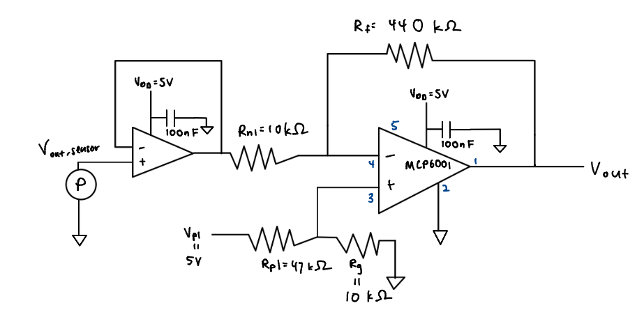
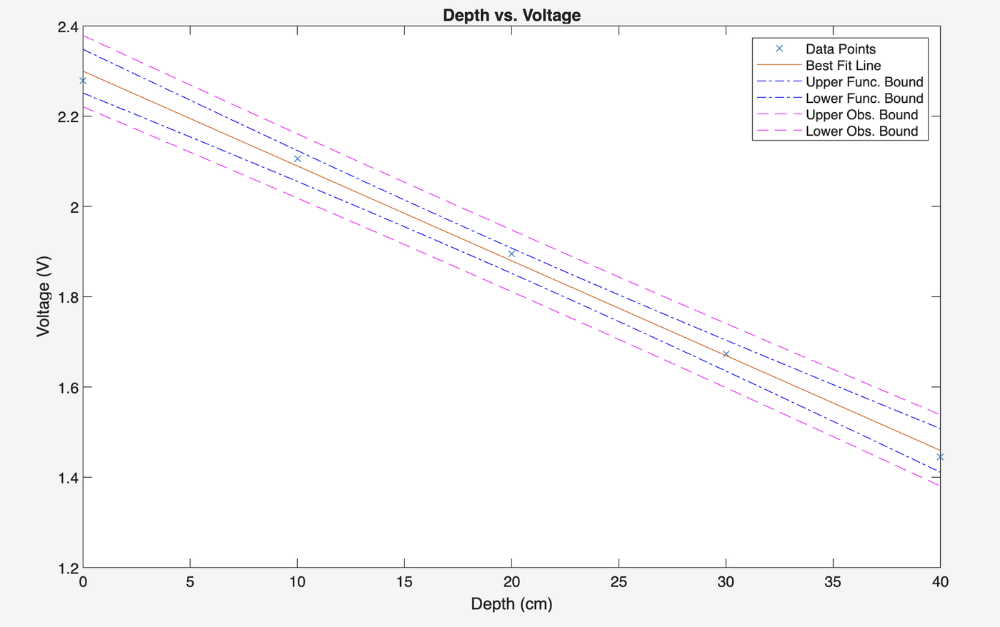
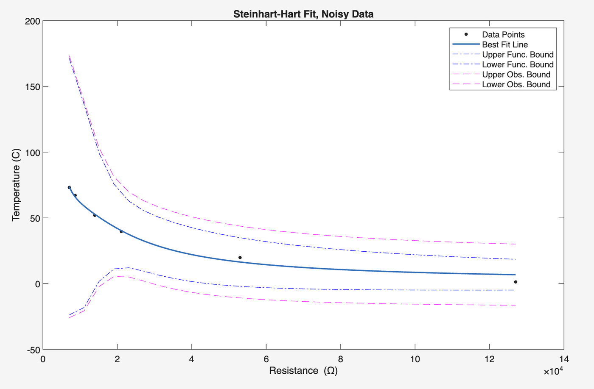

[← All E80 labs](../../e80.qmd)

## Overview

We built signal-conditioning circuits for an MPX5700 pressure sensor and a thermistor, fit the Steinhart–Hart equation to thermistor data, and decoded type-K thermocouple voltages. We also compared how fast each temperature sensor settles. These are the sensors later used on our [final-project AUV](../../autonomous-underwater-robot.qmd).

**Result:** The pressure interface gave a linear depth–voltage response over 0–40 cm. The thermocouple settled in under 1 s, compared with about 4.5 s for the thermistor and 9–15 s for the linear IC sensor.

**Team:** Ben Phung and Lucy Will · [Course lab spec](https://hmc-e80.github.io/labs/lab4)

## Pressure Sensor Interface

The MPX5700's output changes only slightly over a few tens of centimeters of water. A buffer followed by an inverting offset amplifier (MCP6001) maps the 0–40 cm range onto roughly 1.1–2.2 V for the Teensy ADC. The design gain set $R_f/R_{n1} = 43.6$, and the $R_{p1}$–$R_g$ divider sets the offset.

{#fig-pressure width=95% fig-align="center"}

| Depth (cm) | Predicted (V) | Measured (V) | Error | Estimated P (kPa) |
|---:|---:|---:|---:|---:|
| 0 | 2.200 | 2.279 | 3.6% | 96.71 |
| 10 | 1.925 | 2.106 | 9.4% | 97.33 |
| 20 | 1.650 | 1.895 | 14.8% | 98.08 |
| 30 | 1.375 | 1.673 | 21.7% | 98.87 |
| 40 | 1.100 | 1.445 | 31.4% | 99.69 |

{#fig-depth width=95% fig-align="center"}

The measured slope is shallower than designed because the lab lacked the designed parts: we built $R_{p1}$ from 50 kΩ + 10 kΩ and substituted 470 kΩ for the 440 kΩ $R_f$. The response stayed linear and inside the ADC range, so a calibration fit absorbs the gain change. The resistors' 5% tolerance and the sensor's 2.5% accuracy add further spread.

## Thermistor Interface

| Target temp | Predicted R | Predicted V | Measured V | Actual temp | Actual R |
|---:|---:|---:|---:|---:|---:|
| 0 °C | 163 kΩ | 2.987 | 2.68 | 0.4 °C | 167 kΩ |
| 20 °C | 59.3 kΩ | 0.378 | 0.23 | 19.5 °C | 52 kΩ |

Errors come mostly from uneven bath temperatures and from the difference between nominal and actual thermistor resistance, which moves the divider's operating point.

## Steinhart–Hart Fit

$$
\frac{1}{T} = a + b\ln R + c(\ln R)^2 + d(\ln R)^3
$$

| T (°C) | 1.4 | 19.9 | 39.7 | 52.1 | 67.0 | 73.2 |
|---|---:|---:|---:|---:|---:|---:|
| R (kΩ) | 127 | 53 | 21.1 | 14 | 8.7 | 7.1 |

{#fig-sh width=95% fig-align="center"}

| Coefficient | Value | 95% interval |
|---|---:|---|
| $a$ | −4.98 | (−26.56, 16.6) |
| $b$ | 1.622 | (−5.12, 8.364) |
| $c$ | −0.1763 | (−0.8768, 0.5242) |
| $d$ | 0.006417 | (−0.01782, 0.03065) |

The fit follows the data, but with only six points and four parameters the coefficient intervals are very wide. More calibration points would be needed before using this fit for precise temperature conversion.

## Thermocouple Decoding

We set the cold-junction compensation voltage to 0.838 mV, corresponding to 21 °C, then decoded each measured voltage from the type-K table.

| Reference $T_T$ (°C) | Meter $T_K$ (°C) | V (mV) | Decoded $T_D$ (°C) |
|---:|---:|---:|---:|
| 4.4 | 3 | −0.60 | 6 |
| 17.6 | 16 | 0.00 | 21 |
| 29.9 | 29 | 0.43 | 31 |
| 37.3 | 37 | 0.74 | 39 |
| 55.2 | 53 | 1.48 | 58 |
| 79.5 | 79 | 2.51 | 82 |

## Settling Times

| Sensor | Into 0 °C | Into 50 °C |
|---|---:|---:|
| Thermocouple | 0.76 s | 0.87 s |
| Thermistor | 4.6 s | 4.3 s |
| Linear IC sensor | 15.12 s | 8.92 s |

For the robot, the thermistor balances speed against an easy-to-read signal; the thermocouple is fastest but needs more amplification and cold-junction compensation. A cold junction changes slowly, so a thermistor or linear IC sensor is enough for compensation.

## Takeaways

- Real build tolerances and part substitutions change the gain, so calibrate against the built circuit, not the design.
- Report fit coefficients with confidence intervals; wide intervals signal too few calibration points.
- Choose a sensor by response time as well as accuracy.

## References

- [E80 Lab 4 specification](https://hmc-e80.github.io/labs/lab4)
