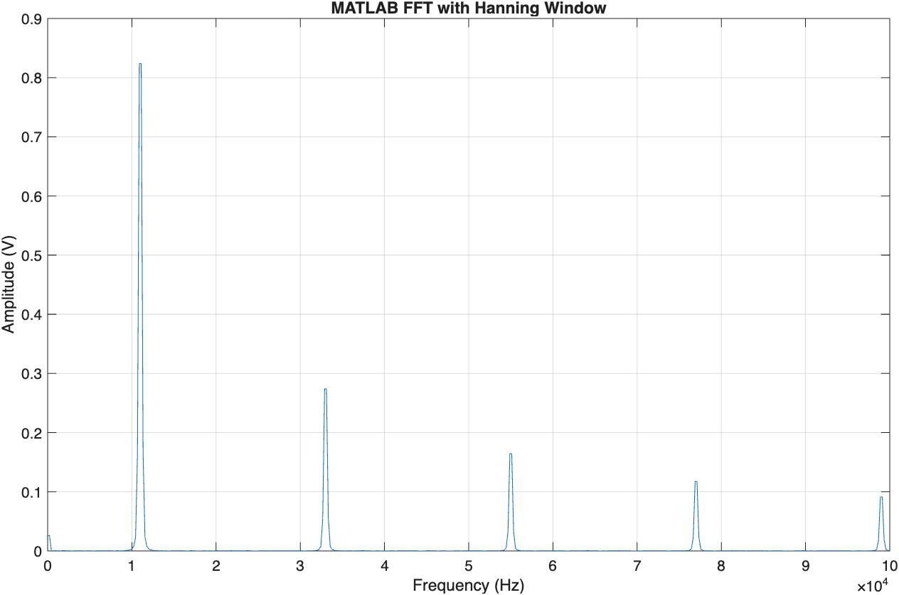
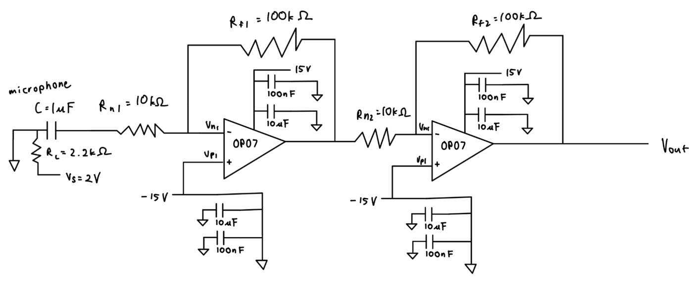
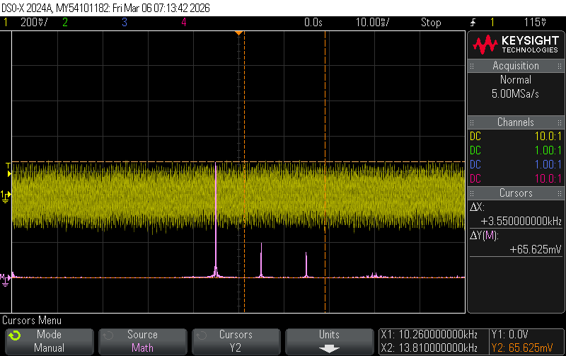
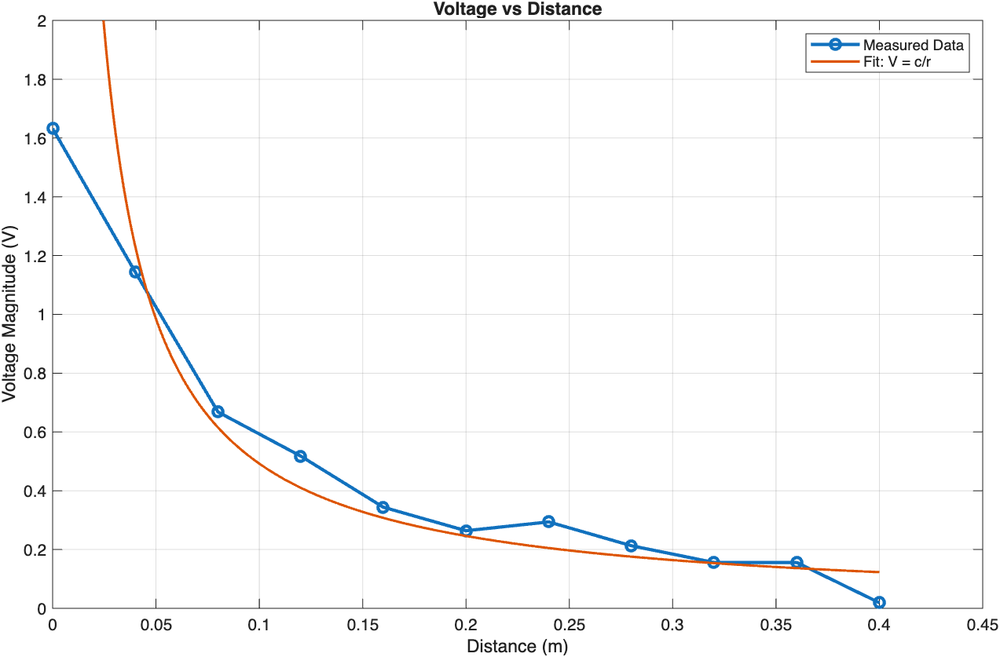
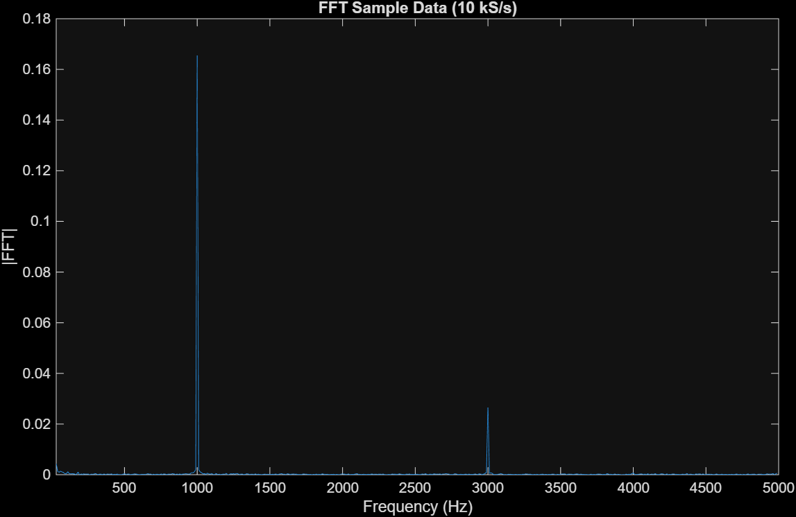
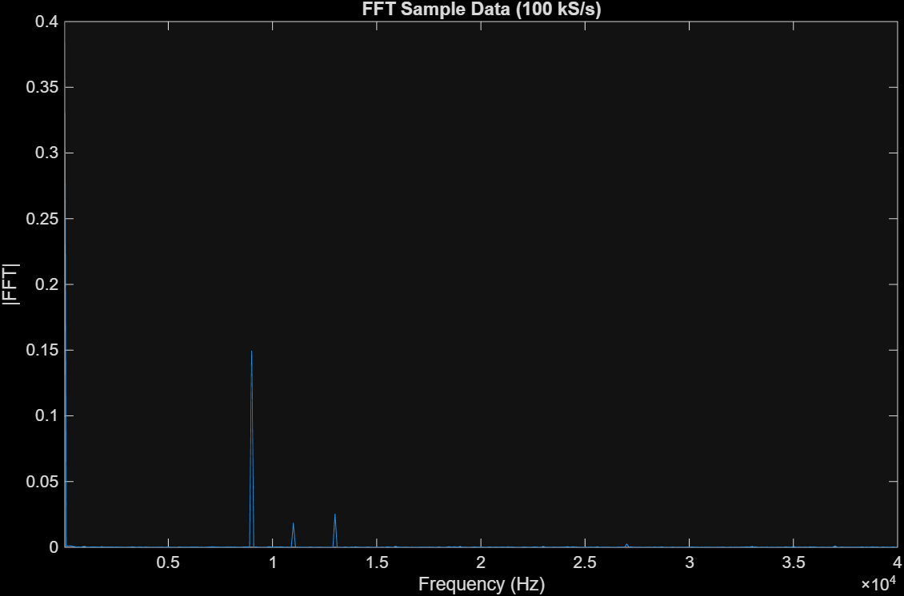

[← All E80 labs](../../e80.qmd)

## Overview

Our team of four used Fourier analysis to listen for three acoustic beacons in the test tank and to estimate position from received amplitude. We characterized FFTs on the oscilloscope and in MATLAB, built a two-stage microphone amplifier, mapped signal strength against distance, and studied aliasing at different Teensy sample rates.

**Result:** We identified the beacons as 9, 13, and 11 kHz. Amplitude followed the expected $V \propto 1/r$ decay, with multipath ripple on top. Sampling at 10 kS/s aliased the beacons below 5 kHz, so we set a minimum rate of **30 kS/s** for the tank.

**Team:** Team 46 (four members) · [Course lab spec](https://hmc-e80.github.io/labs/lab5)

## FFT Fundamentals

An 11 kHz square wave is odd, so its Fourier series contains only odd sine harmonics:

$$
f(t) = \frac{4A}{\pi}\sum_{n\ \text{odd}} \frac{1}{n}\sin\!\left(2\pi n f_0 t\right)
$$

The spectrum therefore has peaks at $f_0, 3f_0, 5f_0, \dots$ = 11, 33, 55, 77, 99 kHz, with amplitudes falling as $1/n$.

{#fig-fft width=95% fig-align="center"}

**Windowing:** an FFT treats the capture as periodic. A rectangular window (no window) leaves discontinuities at the edges, which spread energy into neighboring bins (leakage). A Hanning window tapers the edges to zero, which gives a cleaner spectrum but wider peaks and lower amplitudes. We applied an amplitude correction factor of 2 to compensate.

<details>
<summary>Show MATLAB FFT code</summary>

```matlab
t = scope_296(:,1);  v = scope_296(:,2);
N  = length(v);
Fs = 1/mean(diff(t));
f  = (0:N-1)*(Fs/N);

v_windowed = v .* hann(N);         % Hanning window
Y  = fft(v_windowed);
P2 = abs(Y/N);
P1 = P2(1:N/2+1);
P1(2:end-1) = 2*P1(2:end-1);       % one-sided spectrum
P1 = P1 * 2;                       % window amplitude correction

plot(f(1:N/2+1), P1); xlim([0 100000]);
xlabel('Frequency (Hz)'); ylabel('Amplitude (V)'); grid on;
```

</details>

## Microphone Interface Circuit

The microphone signal needed a gain of 100. A single OP07 stage at a gain of 100 would have little bandwidth, so we split the gain into two inverting stages of 10 each ($R_f/R_n$ = 100 kΩ/10 kΩ). With a gain-bandwidth product of 0.6 MHz:

$$
BW = \frac{GBWP}{G} = \frac{0.6\ \text{MHz}}{10} = 60\ \text{kHz per stage}
$$

This comfortably covers the 9–13 kHz beacons.

{#fig-mic width=100% fig-align="center"}

A hand clap measured 1.241 Vpp, with an FFT peak near 2.5 kHz and content up to about 11 kHz. That sits within human hearing (20 Hz–20 kHz) and overlaps the speech band (100 Hz–4 kHz).

## Beacon Localization

{#fig-beacon width=85% fig-align="center"}

Comparing peak heights at different positions, we identified Beacon 1 as 9 kHz, Beacon 2 as 13 kHz, and Beacon 3 as 11 kHz. Received amplitude was fit to $V = c/r$:

{#fig-decay width=95% fig-align="center"}

**Multipath:** reflections from the tank walls interfere with the direct path. The ripple repeats about once per wavelength ($\lambda = c/f$), so samples must be closer than a quarter-wavelength to resolve it.

| Beacon | Wavelength (c = 1430 m/s) | Sample spacing (λ/4) |
|---:|---:|---:|
| 9 kHz | 0.159 m | 0.040 m |
| 11 kHz | 0.130 m | 0.033 m |
| 13 kHz | 0.110 m | 0.028 m |

## Sampling Rate and Aliasing

::: {.plot-pair}
{#fig-10k}

{#fig-100k}
:::

At 10 kS/s the Nyquist frequency is 5 kHz, so every beacon folds back: $|9-10| = 1$ kHz, $|11-10| = 1$ kHz, $|13-10| = 3$ kHz. To capture the highest beacon, Shannon's theorem requires $f_s \ge 2 \times 13$ kHz $= 26$ kS/s. We used **30 kS/s** for margin.

## Takeaways

- An FFT peak's location and shape depend on sample rate, record length, and window choice.
- Spreading gain across several stages preserves bandwidth.
- Multipath sets how finely a tank survey must be sampled; aliasing sets the minimum sample rate.

## References

- [E80 Lab 5 specification](https://hmc-e80.github.io/labs/lab5)
