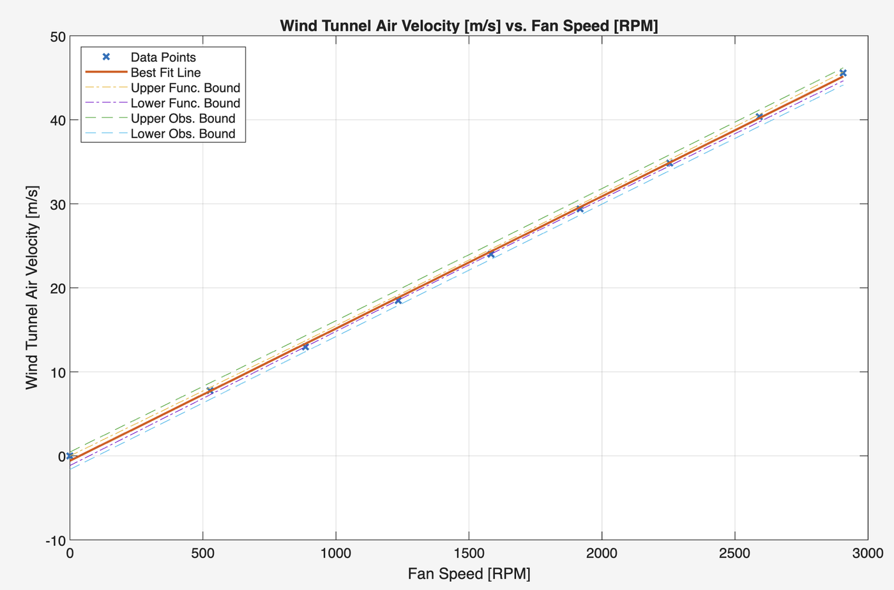
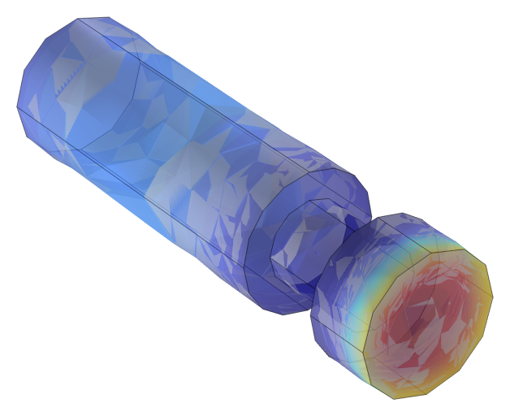
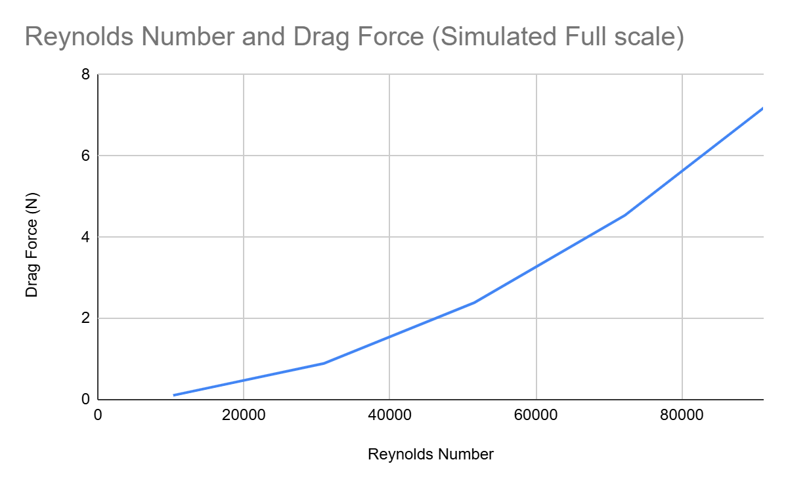
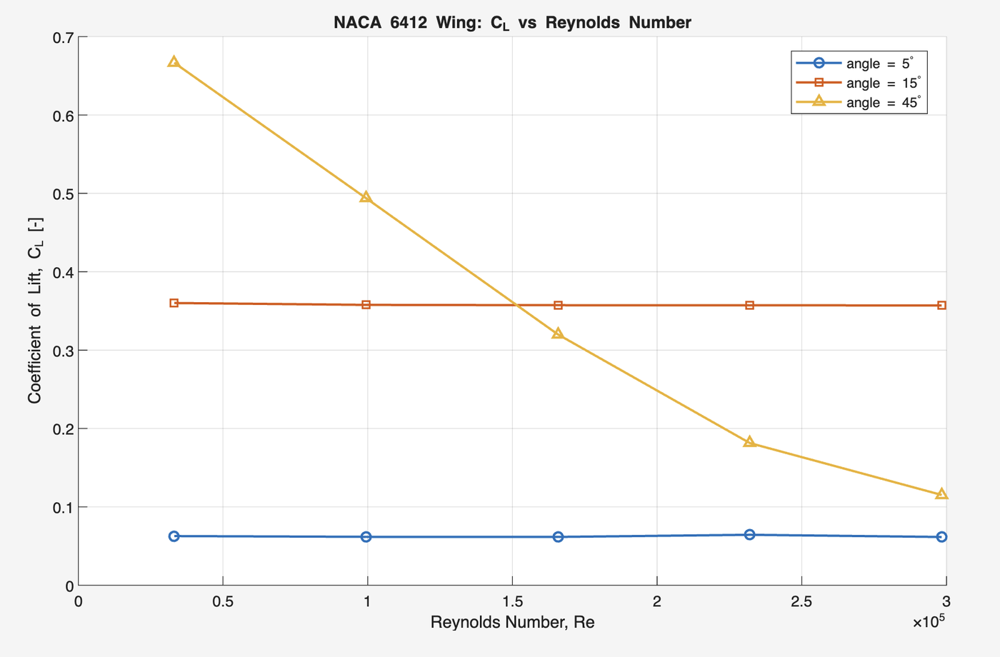

[← All E80 labs](../../e80.qmd)

## Overview

Our team of four measured drag on cylindrical nose cones and a one-third-scale robot model in a wind tunnel, then simulated the same geometries in COMSOL. We also compared lift from a flat plate and a NACA 6412 airfoil, and used similitude to connect air-tunnel results to a full-size robot moving through water.

**Result:** The tunnel's air speed was linear in fan speed up to about 45 m/s. Simulated drag followed the same trends as measured drag, and the NACA 6412 produced more lift than the flat plate at the same angle of attack.

**Team:** Team 46 (four members) · [Course lab spec](https://hmc-e80.github.io/labs/lab6)

## Wind Tunnel Calibration

{#fig-cal width=95% fig-align="center"}

Partway through data collection, the tunnel's emergency stop was bumped and the breakers had to be reset. The instructors confirmed that our data matched what the tunnel reported after the reset. Before each run, we logged the zero-fan-speed drag and lift readings and subtracted them as an offset.

## Drag on Cylindrical Objects

For the cylindrical noses, the characteristic length is the diameter $D = 50$ mm. The reference area is the frontal area:

$$
A = \frac{\pi D^2}{4} = 1.963 \times 10^{-3}\ \text{m}^2, \qquad C_D = \frac{2F_D}{\rho V^2 A}, \qquad Re = \frac{\rho V D}{\mu}
$$

{#fig-nose width=55% fig-align="center"}

## Scale Robot Model and Similitude

The one-third-scale model has a length of 0.0931 m and a frontal area of 0.00164 m². The full-scale robot has a length of 0.2794 m and a frontal area of 0.01476 m².

**Similitude:** if the Reynolds numbers match, the flow around a small model in air behaves like the flow around the full-size robot in water. Tunnel measurements on the scale model can therefore predict full-scale drag.

{#fig-robot width=90% fig-align="center"}

Simulated drag follows the measured trend but differs in magnitude. CFD assumes smooth surfaces and an idealized mesh. The tunnel adds sensor noise, mounting interference, surface roughness, and small misalignments, and the physical robot has more geometric detail than the simplified model.

## Lift: Flat Plate vs. NACA 6412

For the wings, the chord $c = 0.1$ m is the characteristic length. The reference area is the planform area $A = cL = 0.1 \times 0.3 = 0.03$ m².

{#fig-naca width=95% fig-align="center"}

At a 15° angle of attack, the pressure is higher under each wing than above it, which produces lift. The NACA 6412 had a higher lift coefficient and a larger pressure difference than the flat plate, because its cambered shape speeds up the flow over the upper surface. At 45°, its $C_L$ falls steeply as $Re$ increases, which is consistent with the flow separating at that steep angle.

## Takeaways

- Simulation, hand analysis, and measurement should agree on trends; differences in magnitude point to modeling assumptions.
- Matching Reynolds number is what makes scale-model testing valid.
- Wing shape matters: camber increases lift at moderate angles of attack.

## References

- [E80 Lab 6 specification](https://hmc-e80.github.io/labs/lab6)
