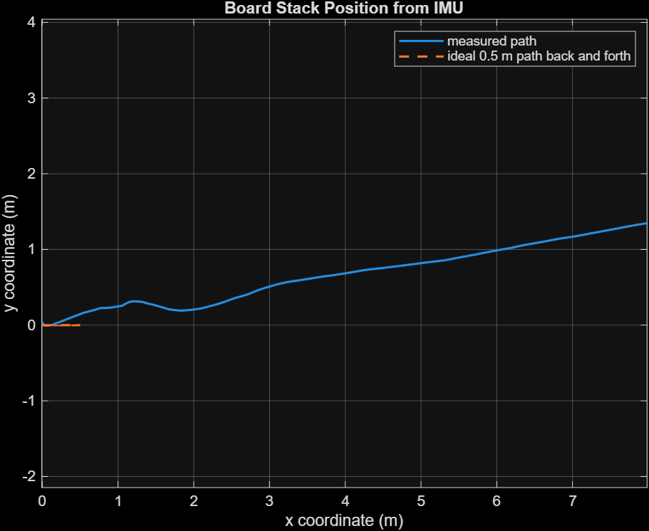
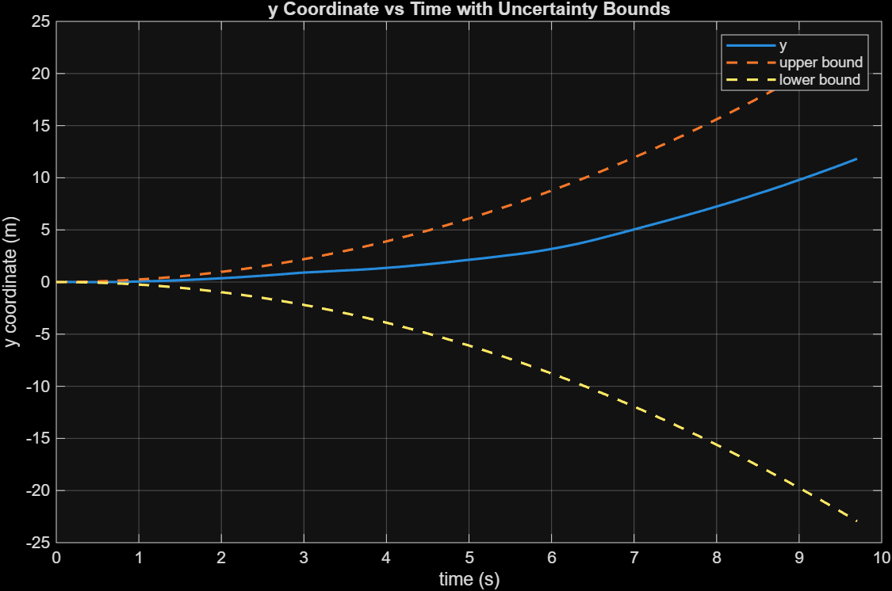
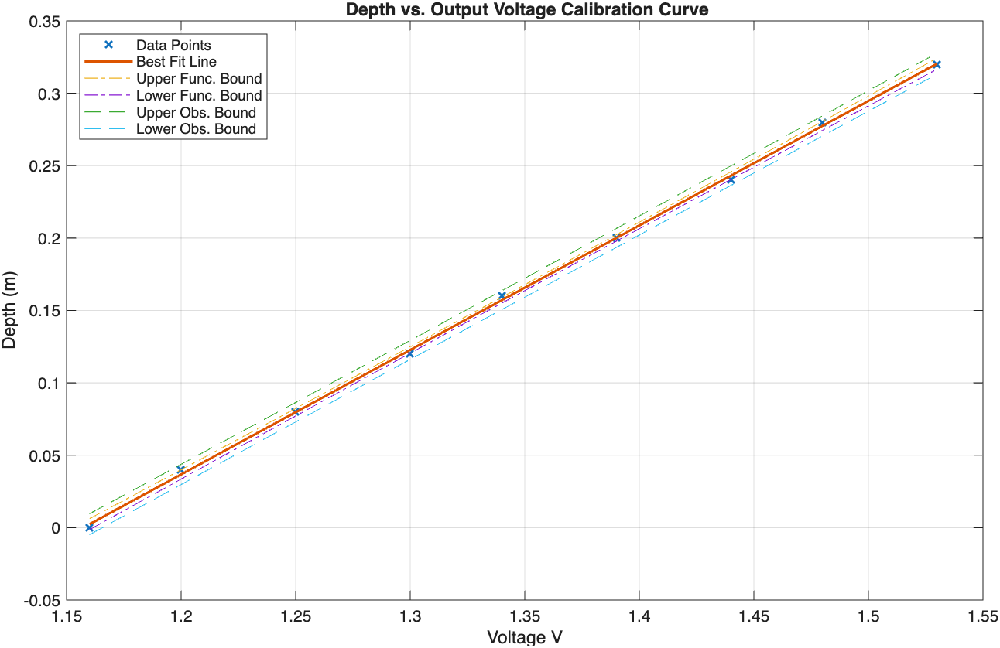
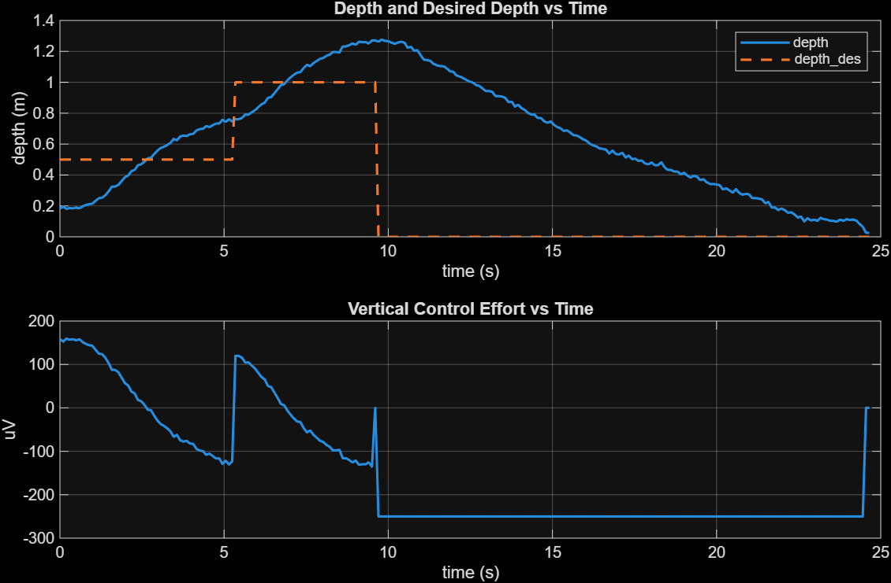

[← All E80 labs](../../e80.qmd)

## Overview

The Project Jump Start moved the robot from timed open-loop motion to sensor feedback. We extended the logging firmware, tested IMU-based position estimates, calibrated the pressure sensor for depth, and implemented proportional depth control for an autonomous dive.

**Result:** The calibrated depth sensor drove a P-controller that tracked a two-step dive and then returned the robot to the surface. IMU dead reckoning drifted by meters within seconds, which ruled it out for position estimation.

**Team:** Team 46 (four members) · [Course project overview](https://hmc-e80.github.io/project/overview)

## Firmware Changes

We added magnetometer output to `printRollPitchHeading()` and extended the main-loop printer to report the ADC, GPS, state estimators, depth controller, motors, and IMU.

<details>
<summary>Show printer changes</summary>

```cpp
String SensorIMU::printRollPitchHeading(void) {
  String printString = "IMU:";
  printString += " roll: ";    printString += String(state.roll);    printString += "[deg],";
  printString += " pitch: ";   printString += String(state.pitch);   printString += "[deg],";
  printString += " heading: "; printString += String(state.heading); printString += "[deg]";
  printString += String(state.magX); printString += "[uT]";
  return printString;
}
```

```cpp
if (currentTime - printer.lastExecutionTime > LOOP_PERIOD) {
  printer.lastExecutionTime = currentTime;
  printer.printValue(0,  adc.printSample());
  printer.printValue(1,  button_sampler.printState());
  printer.printValue(2,  logger.printState());
  printer.printValue(3,  gps.printState());
  printer.printValue(4,  xy_state_estimator.printState());
  printer.printValue(5,  z_state_estimator.printState());
  printer.printValue(6,  depth_control.printWaypointUpdate());
  printer.printValue(7,  depth_control.printString());
  printer.printValue(8,  motor_driver.printState());
  printer.printValue(9,  imu.printRollPitchHeading());
  printer.printValue(10, imu.printAccels());
  printer.printToSerial();
}
```

</details>

`LOOP_PERIOD` in `TimingOffsets.h` is 99 ms, so the main loop samples at

$$
f_{samp} = \frac{1}{0.099\ \text{s}} \approx 10.1\ \text{Hz}
$$

## Position from the IMU

We moved the board stack 0.5 m forward and back, then double-integrated the accelerometer data to estimate position.

::: {.plot-pair}
{#fig-path}

{#fig-ybounds}
:::

Integrating accelerometer noise twice makes the position error grow without bound. Within 10 s the estimate drifted several meters from a 0.5 m move, although it stayed inside the theoretical bounds. Navigation needs an external reference, such as GPS at the surface or depth from pressure.

## Pressure-to-Depth Calibration

{#fig-depthcal width=95% fig-align="center"}

| Parameter | Value |
|---|---:|
| `depthCal_slope` | 0.859784 m/V |
| `depthCal_intercept` | −0.994977 m |

## Proportional Depth Control

```cpp
depth_des   = wayPoints[currentWayPoint];
depth       = state->z;
depth_error = depth_des - depth;
uV = Kp * depth_error;
if (uV >  200) uV =  200;   // saturate control effort
if (uV < -200) uV = -200;
```

{#fig-dive width=100% fig-align="center"}

The robot followed the 0.5 m and 1.0 m waypoints, overshooting to about 1.27 m before climbing back to the surface. At the instructor's suggestion, we ran with $K_p = 500$ and an ascent effort of −250, which made the control effort aggressive and noisy. Effort decays as depth approaches the setpoint and then saturates during the ascent, which is the expected behavior of P-control on depth.

## Takeaways

- Dead reckoning from an accelerometer alone is unusable after a few seconds.
- A calibrated pressure sensor is a reliable depth reference for closed-loop control.
- With P-control, the gain trades response speed against overshoot; a derivative term or a lower gain would reduce the overshoot.

## References

- [E80 project overview](https://hmc-e80.github.io/project/overview)
- [E80 source code](https://github.com/HMC-E80/E80)
