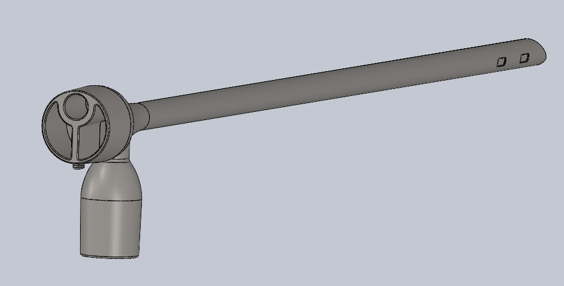
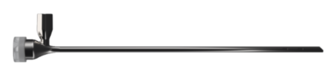
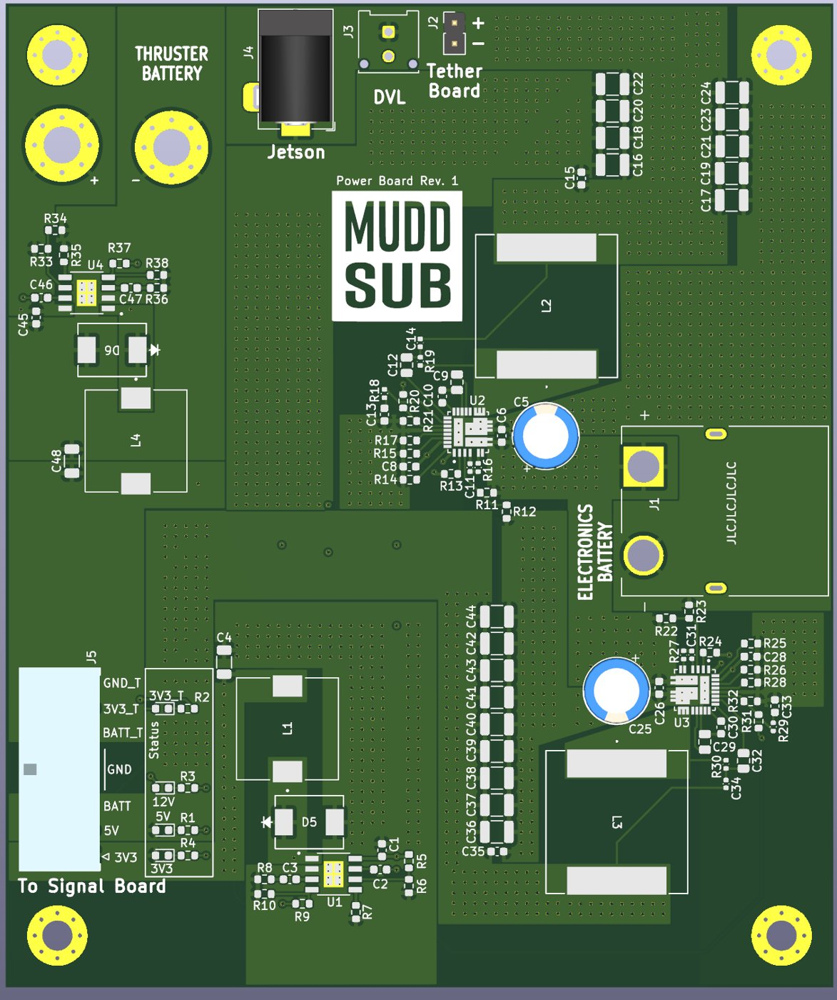

## Partnerships for Global Surgery: Sponsored Engineering Project {#pediatric-bronchoscope}

```{=html}
<section class="project-overview sponsored-overview" aria-label="Partnerships for Global Surgery project">
  <div class="project-overview-media sponsored-overview-media">
    
  </div>
  <div class="project-overview-body">
    <span class="tag">Sponsored engineering project · 2026–present · In progress</span>
    <p><strong>Pediatric rigid bronchoscope</strong><br>
    Working with a seven-person Clinic team, surgeons, and engineers on an affordable pediatric rigid bronchoscopy system. The project is currently in design and preliminary prototype evaluation, with manufacturing and simulated validation still ahead.</p>
    <p><strong>My ownership</strong><br>
    Distal-camera selection and integration, handle ideation, camera-cleaning prototypes, and endoscope heat testing.</p>
    <a class="action action-outline" href="pediatric-bronchoscope.html">Full Project Page →</a>
  </div>
</section>
```

{.sponsored-device fig-alt="Manufactured pediatric bronchoscope prototype"}

## Data Pillar
**Engineering Intern · May–August 2025**

Developed Python tools for data processing, collaborated on C++ data-pipeline modules, and used MATLAB analysis and client feedback to guide backend improvements.

## MuddSub

```{=html}
<section class="project-overview sponsored-overview" aria-label="MuddSub PCB project">
  <div class="project-overview-media sponsored-overview-media muddsub-experience-media">
    
  </div>
  <div class="project-overview-body">
    <span class="tag">PCB Team Member · January 2026–present</span>
    <p><strong>AUV power and signal electronics</strong><br>
    Contribute to team-based board design and validation for MuddSub's eight-thruster autonomous underwater vehicle, including regulated power, thruster control, embedded interfaces, and the mechanical realities of underwater integration.</p>
    <p><strong>Beyond the boards</strong><br>
    Contribute to chassis packaging, waterproofing, buoyancy, connector access, and serviceability so the electrical stack can be installed and tested as part of the complete vehicle.</p>
    <div class="project-links">
      <a class="action action-outline" href="muddsub.html">Full Project Page →</a>
      <a class="action action-outline" href="https://muddsub.org/" target="_blank" rel="noopener">Team Website</a>
    </div>
  </div>
</section>
```

## Adaptive Design at Mudd
**Design Engineer · January 2024–present**

Prototype assistive devices for community members using CAD and 3D printing, including a GIC checkerboard and wheelchair components.

## Technical toolkit

| Area | Tools and methods |
|---|---|
| Embedded and digital | STM32, Arduino, Raspberry Pi, FPGA, RISC-V, SPI, UART, C/C++, SystemVerilog |
| Design and fabrication | SolidWorks, KiCad, Altium, 3D printing, machining, laser cutting |
| Analysis | Python, MATLAB, COMSOL, LTspice, oscilloscope and logic-analyzer debugging |
