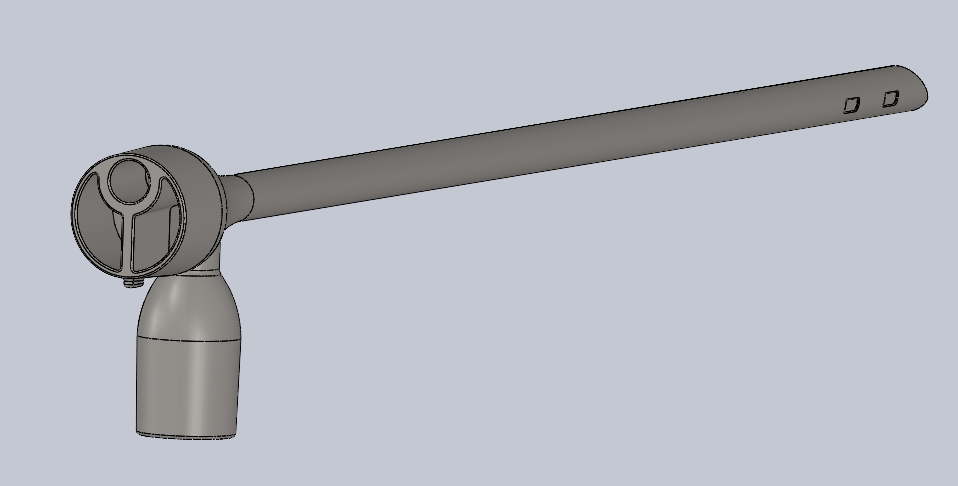
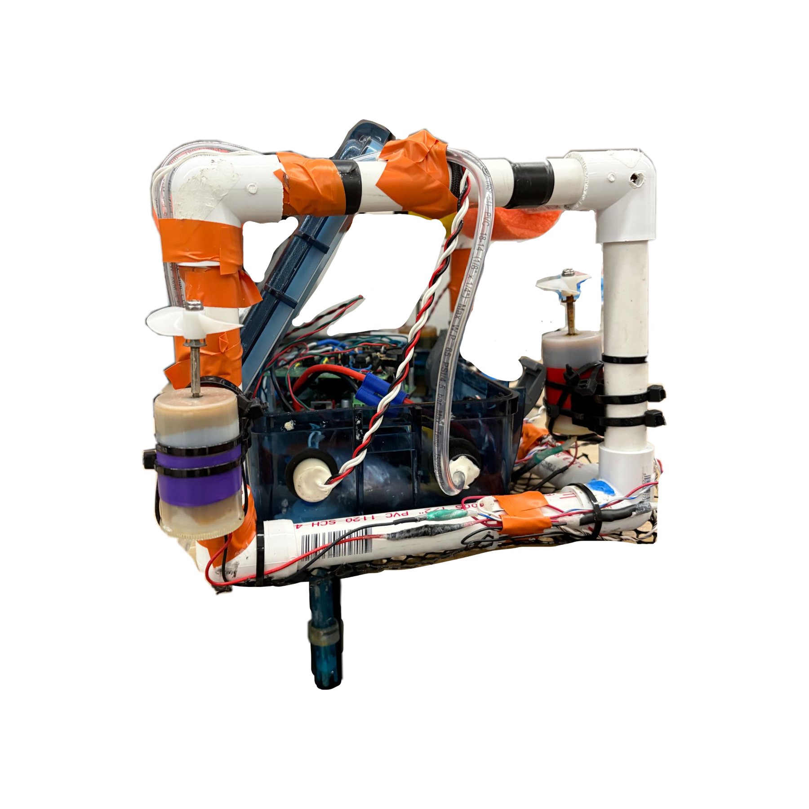
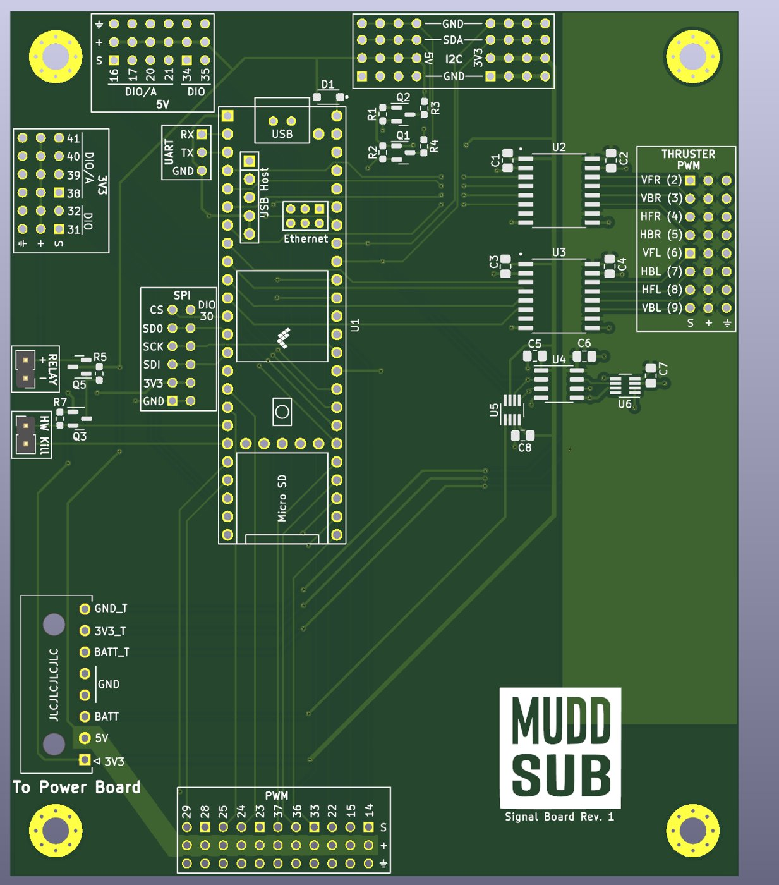
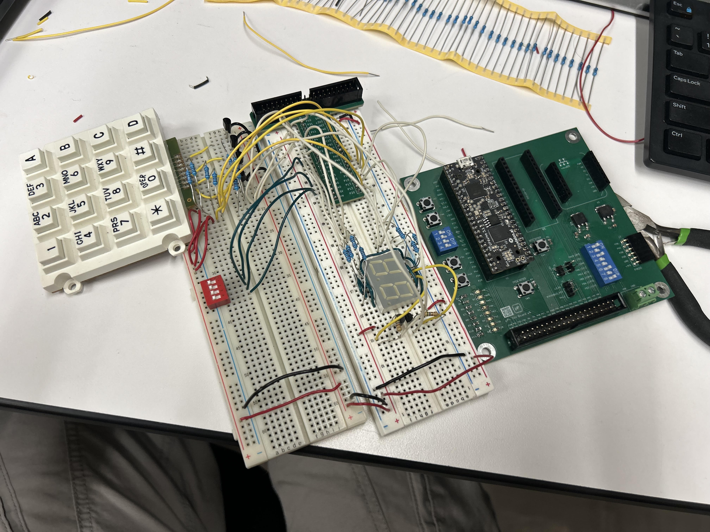
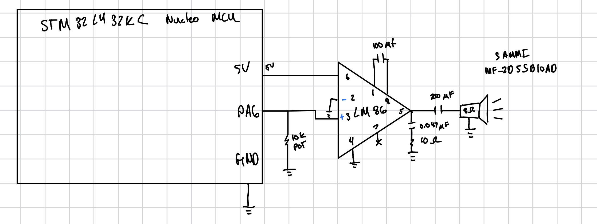
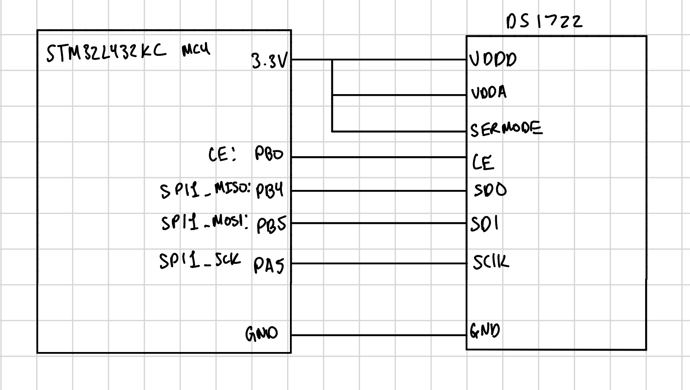

```{=html}
<section class="hero" aria-labelledby="hero-title">
  <div class="hero-text">
    <span class="eyebrow">Harvey Mudd College / Engineering / Class of 2028</span>
    <h1 id="hero-title" class="hero-name">Ben Phung</h1>
    <p class="hero-tagline">I design, build, and test hardware across embedded systems, robotics, medical devices, and manufacturing.</p>
    <div class="chip-row" aria-label="Areas of work"><span class="chip">Embedded Systems</span><span class="chip">PCB Design</span><span class="chip">Robotics</span><span class="chip">Prototyping</span></div>
    <div class="hero-actions">
      <a class="action action-primary" href="projects.html">See Projects</a>
      <a class="action action-outline" href="experience.html">Experience</a>
      <a class="action action-outline" href="Images/Ben-Phung-Resume.pdf" target="_blank" rel="noopener">Resume</a>
      <a class="action action-icon" href="mailto:bphung.college@gmail.com" aria-label="Email Ben"><i class="bi bi-envelope-fill" aria-hidden="true"></i></a>
      <a class="action action-icon" href="https://github.com/bphung-01" aria-label="Ben on GitHub"><i class="bi bi-github" aria-hidden="true"></i></a>
    </div>
  </div>
  <div class="hero-photo"></div>
</section>
```

## Current Work

```{=html}
<div class="now-grid">
  <div class="now-item"><div class="now-label">Sponsored project · In progress</div><p><a href="pediatric-bronchoscope.html"><strong>Pediatric bronchoscopy</strong></a>: integrating and testing a distal-camera system for an affordable rigid scope.</p></div>
  <div class="now-item"><div class="now-label">Robotics</div><p><a href="muddsub.html"><strong>MuddSub</strong></a>: contributing to PCB design and verification for an autonomous underwater vehicle.</p></div>
  <div class="now-item"><div class="now-label">Building</div><p><a href="projects.html#laser-tag-system"><strong>IR laser tag</strong></a>: developing blasters, vests, and a local scoreboard with STM32 and FPGA hardware.</p></div>
  <div class="now-item"><div class="now-label">Coursework</div><p><a href="microps.html"><strong>Microprocessors</strong></a>: documenting FPGA, STM32, sensor, and communication labs.</p></div>
</div>
```

## Featured Work {#featured-work}

```{=html}
<div class="card-grid">
  <a class="work-card" href="pediatric-bronchoscope.html"><div class="thumb thumb-contain"></div><div class="card-body"><span class="tag">Sponsored project · Work in progress</span><h3>Pediatric Bronchoscope</h3><p>Distal-camera integration, cleaning concepts, thermal testing, and system verification planning.</p></div></a>
  <a class="work-card" href="autonomous-underwater-robot.html"><div class="thumb thumb-contain"></div><div class="card-body"><span class="tag">E80 · Robotics + sensors</span><h3>Autonomous Underwater Robot</h3><p>Depth-resolved pressure, temperature, pH, and light sensing deployed at Dana Point.</p></div></a>
  <a class="work-card" href="muddsub.html"><div class="thumb thumb-contain"></div><div class="card-body"><span class="tag">MuddSub · PCB team member</span><h3>AUV Power + Signal Boards</h3><p>Team-based power distribution, thruster control, embedded interfaces, and underwater integration.</p></div></a>
  <a class="work-card" href="microps.html"><div class="thumb thumb-contain"></div><div class="card-body"><span class="tag">E155 · FPGA + MCU</span><h3>Microprocessors</h3><p>FPGA display logic, keypad scanning, STM32 audio, motor interrupts, and SPI.</p></div></a>
  <a class="work-card" href="multicycle-processor.html"><div class="thumb thumb-type thumb-processor" aria-hidden="true"><span>RISC–V<br>PROCESSOR</span><small>03 / SYSTEMVERILOG</small></div><div class="card-body"><span class="tag">Computer engineering · Digital design</span><h3>Multicycle Processor</h3><p>A hierarchical 32-bit processor verified through a complete machine-code program.</p></div></a>
  <a class="work-card" href="labs/lab4/lab4.html"><div class="thumb thumb-contain"></div><div class="card-body"><span class="tag">E155 · STM32</span><h3>Digital Audio</h3><p>Hardware timers and an LM386 amplifier play a melody with measured pitch checks.</p></div></a>
  <a class="work-card" href="labs/lab6/lab6.html"><div class="thumb thumb-contain"></div><div class="card-body"><span class="tag">E155 · SPI + IoT</span><h3>SPI and the Internet of Things</h3><p>An STM32 reads a DS1722 sensor and uses an ESP8266 for local web control.</p></div></a>
</div>
```

```{=html}
<div class="section-end"><a href="projects.html">All projects <span aria-hidden="true">→</span></a><a href="microps.html">Microprocessors reports <span aria-hidden="true">→</span></a></div>
```
