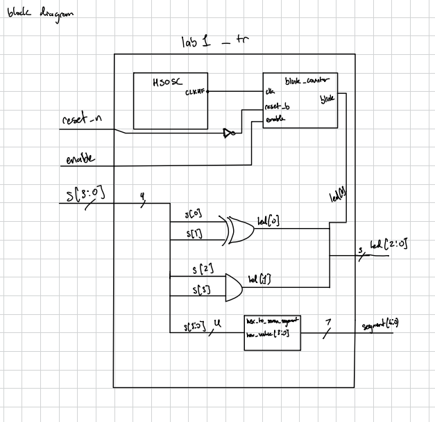
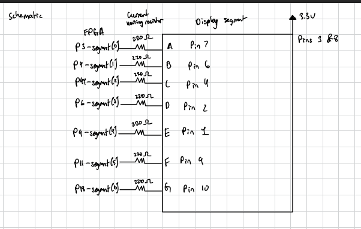
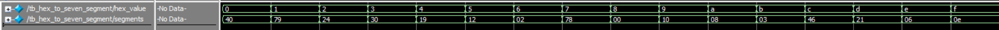
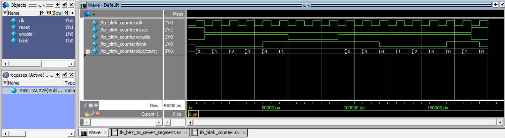
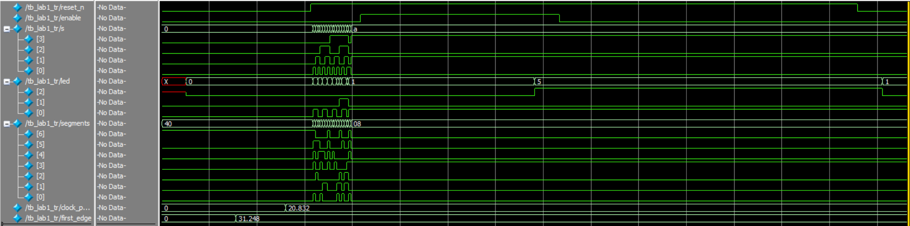
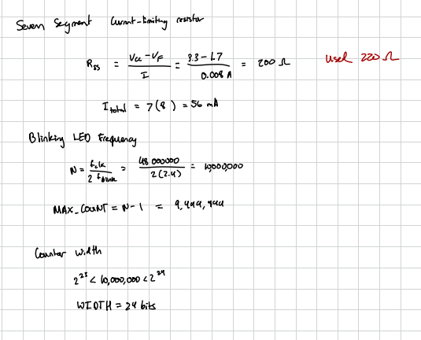

## Design

Four switches select a hexadecimal digit. Two LEDs implement XOR/AND logic; a third blinks at a nominal **2.4 Hz**.

| Item | Implementation |
|---|---|
| FPGA | iCE40UP5K, SG48 package |
| Clock | Internal HSOSC, nominal 48 MHz |
| Display | HDSP-511A, single digit, common anode |
| Segment resistors | Seven 220 Ω resistors |
| Decoder | Combinational `case`; active-low `segments[6:0]` = G–A |
| Counter | Width 24; maximum 9,999,999; reset and enable |
| LED logic | `led[0] = s[1] ^ s[0]`; `led[1] = s[3] & s[2]` |

**Code repository:** https://github.com/bphung-01/E155-Lab-Redo

## Block Diagrams

The block diagram shows the complete Lab 1 FPGA design, including the internal oscillator, counter, seven-segment decoder, LED logic, and top-level connections.

View complete Lab 1 block diagram

{width=100%}

## Circuit Schematic

Each cathode connects through its own resistor to the FPGA. Both common anodes connect to 3.3 V; the decimal point is unused.

Display schematic and wiring

{width=100%}

| Signal | Display pin | FPGA adapter label |
|---|---:|---|
| A / `segments[0]` | 7 | P3 |
| B / `segments[1]` | 6 | P4 |
| C / `segments[2]` | 4 | P44 |
| D / `segments[3]` | 2 | P6 |
| E / `segments[4]` | 1 | P9 |
| F / `segments[5]` | 9 | P11 |
| G / `segments[6]` | 10 | P18 |
| Common anodes | 3 and 8 | 3.3 V |
| Decimal point | 5 | Unconnected |

Onboard DIP switches and LEDs use the development board's existing circuitry. Switch inputs use internal pull-ups. **TODO:** confirm this pin table against the final Radiant Signal/Pad report and add the final `reset_n`/`enable` pin assignments.

## Simulation

Questa testbenches reported PASS for the decoder, counter, and top-level connections.

Hexadecimal decoder waveform

{width=100%}

Inputs step from `0` to `F`; each produces the expected segment pattern. For example, `0` gives `7'h40` and `8` gives `7'h00`. Zero bits illuminate segments.

Counter waveform

{width=100%}

With the test maximum set to 3, the count cycles `0 → 1 → 2 → 3 → 0`. Rollover toggles `blink`. Disabling holds both values; reset clears them on the next rising clock edge. Initial red values occur before the first reset clock edge.

Top-level waveform

{width=100%}

The simulated oscillator period is approximately **20.832 ns**. The test checks both LED expressions, decoder connections, reset, enable, and blinking with `MAX_COUNT=3`. This shortened test verifies connections; it does not measure the hardware's 2.4 Hz blink rate.

## Calculations

{width=100%}

-->

## Results

| Check | Status |
|---|---|
| Radiant synthesis, mapping, routing, and export | Completed |
| FPGA programming | Completed |
| Switch-controlled display and LEDs | Working at the final hardware check |
| Decoder, counter, and top-level simulations | PASS reported |
| All sixteen digits unique; adjacent switches follow bit order | Completed |
| Equal brightness; unselected segments completely off | Completed |

**Requirements statement:** FPGA functionality and the listed simulations were demonstrated. Full completion remains subject to the outstanding checks above; the MCU test was not completed in the recorded session.

## AI Prototype and Reflection

I prompted generative AI to create an automatic testbench for the hexadecimal seven-segment decoder. Instead of manually testing each switch combination, the AI-generated approach stored the 16 expected segment patterns and used a loop with assertions to test every input from `0x0` through `0xF`.

The first version required minor syntax corrections before compiling in Questa. After correcting it, the testbench passed all 16 input-output pairs. This prototype showed that AI can reduce repetitive testbench code, but the generated code still needs to be understood, compiled, and verified by the designer.

## Time Spent

**20 hours.**

## References

- [Lab 1 instructions](https://hmc-e155.github.io/lab/lab1/)
- [Lab 1 specifications](https://hmc-e155.github.io/lab/lab1/specs.html)
