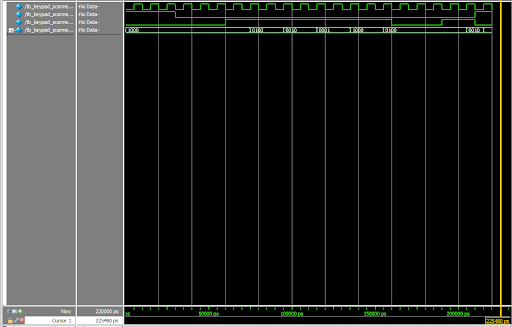
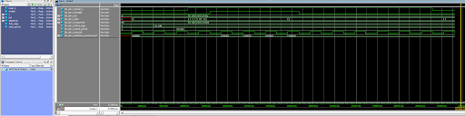
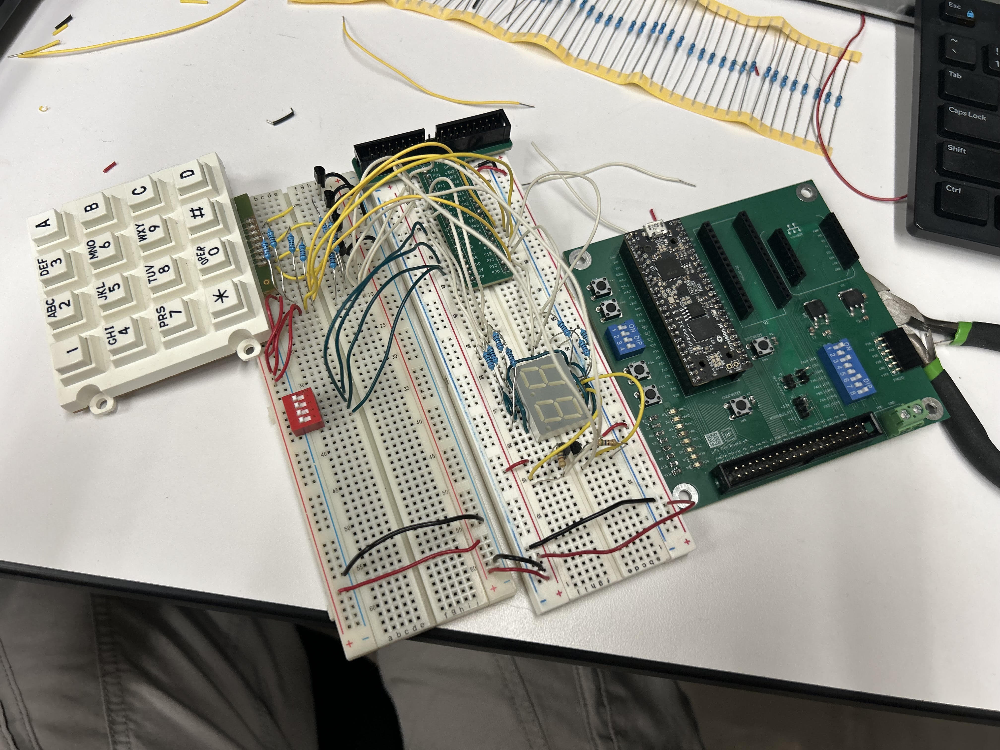

## Introduction

Two independently controlled hexadecimal digits were time-multiplexed through one seven-segment decoder. A 4 × 4 keypad scanner drove four open-collector rows and displayed the sensed columns on four LEDs.

## Design

| Function | Implementation |
|---|---|
| Display inputs | Two 4-bit DIP-switch values |
| Segment decoder | One shared `hex_to_seven_segment` instance |
| Digit selection | Multiplexing counter and two PNP switches |
| Keypad rows | Four rotating open-collector NPN outputs |
| Keypad columns | Pull-up resistors and four FPGA inputs |
| Indicators | `led[3:0] = ~col_n[3:0]` |

### Block Diagram

{#fig-block-diagram width=100%}

### Schematic

{#fig-schematic width=100%}

### Source Code

[GitHub repository](https://github.com/bphung-01/E155-Lab2)

<details>
<summary>Design files</summary>

- `lab2_tr.sv`
- `keypad_scanner.sv`
- `blink_counter.sv`
- `hex_to_seven_segment.sv`

</details>

## Calculations

The calculations below verify the FPGA pin currents and circuit timing.

{#fig-calculations width=90%}

## Simulation

### Keypad Scanner

{#fig-scanner-waveform width=100%}

```text
PASS: scanner reset, enable, pause, and all four row transitions.
```

### Top Level

{#fig-top-waveform width=100%}

```text
PASS: one decoder is shared, the digits alternate, and the LED outputs invert the column inputs.
```

<details>
<summary>Testbench files</summary>

- `tb_keypad_scanner.sv`
- `tb_lab2_tr.sv`

</details>

## Hardware Results

| Test | Result |
|---|---|
| Two independent hexadecimal digits | Pass |
| One shared decoder | Pass |
| No visible digit bleeding | Pass |
| No visible flicker | Pass |
| Four rotating keypad rows | Pass |
| Keypress displayed on corresponding LED | Pass |
| Two simultaneous keypresses | Pass |

<details>
<summary>Hardware photograph</summary>

{width=85%}

</details>

## Requirements

The design met all requirements.

## AI Prototype

<details>


**Reflection:** # AI Prototype Summary

AI was used to generate an initial HDL structure, testbenches, and wiring plan. The prototype suggested reusing the Lab 1 counter, sharing one seven-segment decoder between both digits, and scanning the keypad rows with a counter. The generated design provided a useful starting point but required corrections to match the active-low display signals, actual FPGA pin assignments, component values, and physical wiring. QuestaSim verified the digital behavior, while hardware testing was still necessary to find wiring and power problems. This showed that AI was helpful for organizing and checking the design, but its output needed to be compared carefully against the datasheets, lab specifications, and assembled circuit.

## Conclusion

The FPGA successfully multiplexed two hexadecimal digits and scanned the 4 × 4 keypad. Total time: 15 hours.
