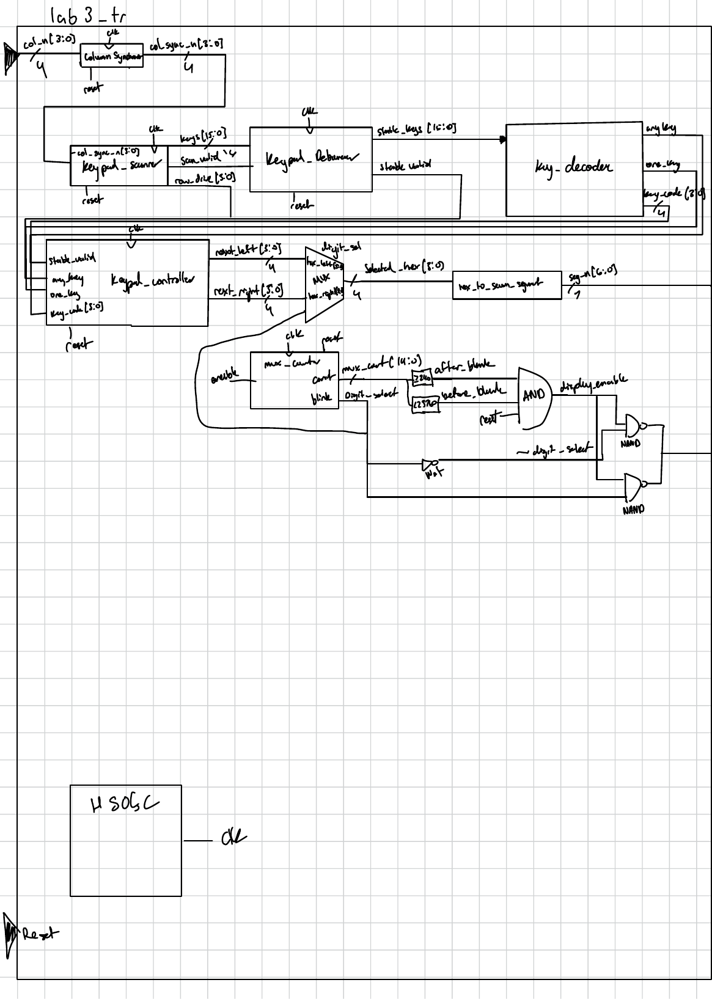
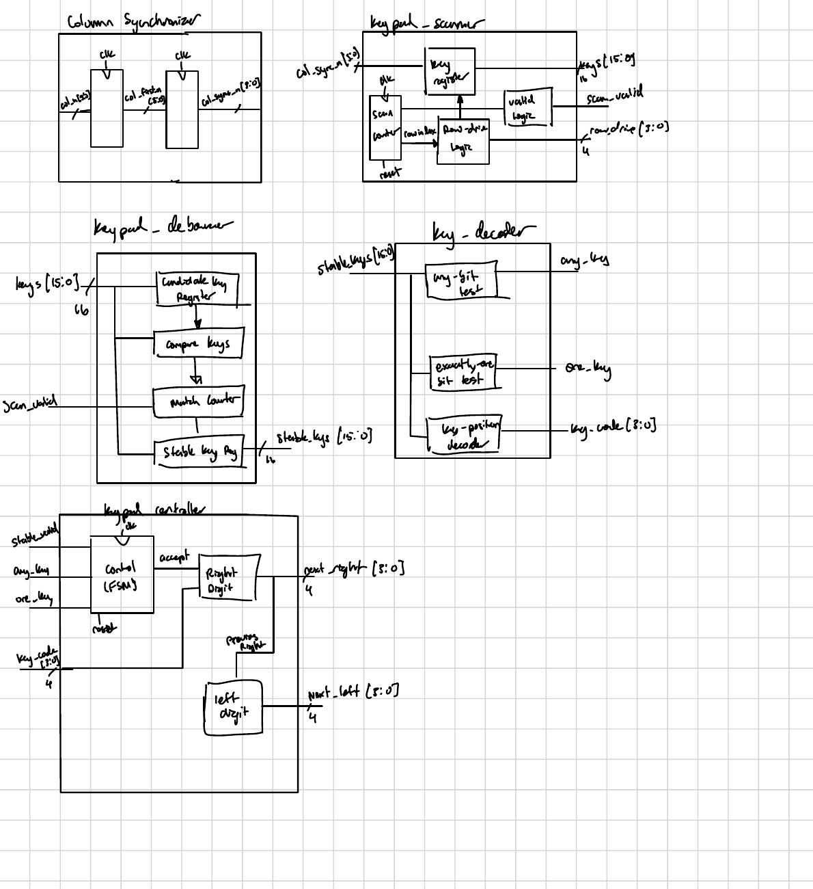
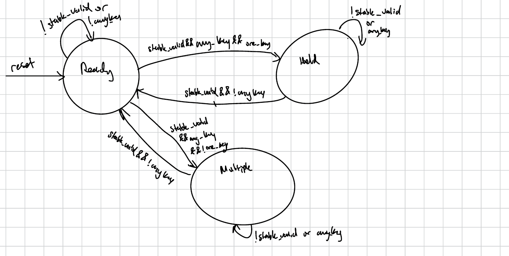
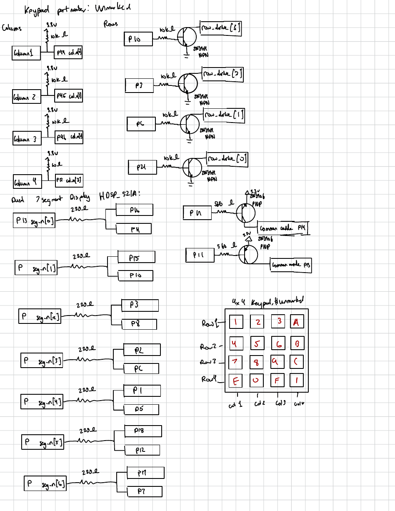
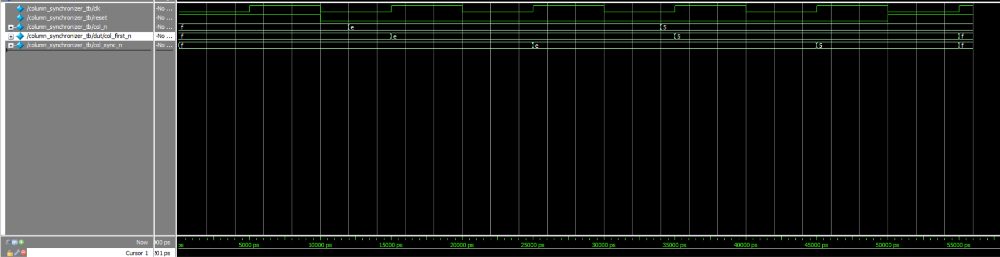
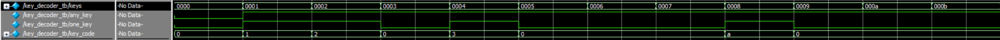
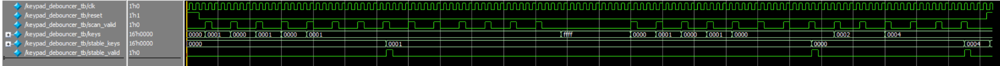
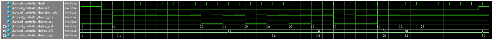
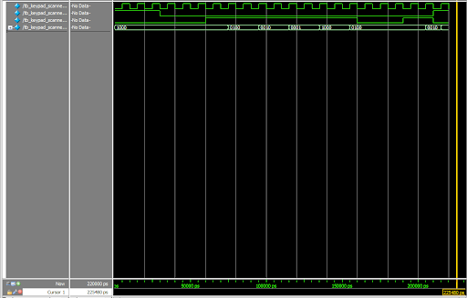
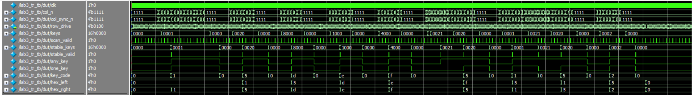

## Introduction

In Lab 3, I extended the Lab 2 keypad and multiplexed display system to record key presses. The FPGA scans a 4 × 4 keypad and displays the two most recently accepted hexadecimal keys, with the newest key on the right. The design synchronizes the keypad inputs, filters changes across scans, rejects simultaneous keys, and prevents a held key from being recorded repeatedly. I reused the Lab 2 display circuitry.

## Design and testing methodology

The column synchronizer brings the asynchronous, active-low keypad columns into the FPGA clock domain. The keypad scanner drives the rows and produces a 16-bit key map for each scan. The debouncer accepts a key map after it remains consistent; the decoder determines whether zero, one, or multiple keys are active and produces a hexadecimal key code. The controller decides when to shift a new key into the two display registers. The existing multiplexing circuit selects which register drives the shared seven-segment decoder.

I tested the new modules individually before simulating the complete system. The testbenches exercised reset, key changes, held keys, multiple keys, and the resulting display updates.

### Block diagram

{#fig-lab3-block width=100%}

{#fig-lab3-details width=100%}

### Controller FSM

{#fig-lab3-fsm width=85%}

The controller starts in `Ready`. A stable single-key sample is accepted once and moves the controller to `Hold`. Repeated samples of the same held key do not change the display. If additional keys are pressed, the controller moves to `Multiple` and holds the displayed digits. When the multiple-key input becomes one stable key, it accepts that remaining key and returns to `Hold`.

### State transition table

| Current state | Input condition | Next state | Display action |
|---|---|---|---|
| `Ready` | `!stable_valid` or no key pressed | `Ready` | Hold both digits |
| `Ready` | `stable_valid && one_key` | `Hold` | Move the right digit left; load `key_code` on the right |
| `Ready` | `stable_valid && any_key && !one_key` | `Multiple` | Hold both digits |
| `Hold` | `stable_valid && !any_key` | `Ready` | Hold both digits |
| `Hold` | `stable_valid && any_key && !one_key` | `Multiple` | Hold both digits |
| `Hold` | `stable_valid && one_key && key_code != held_key` | `Hold` | Move the right digit left; load `key_code` on the right |
| `Hold` | Otherwise | `Hold` | Hold both digits |
| `Multiple` | `stable_valid && !any_key` | `Ready` | Hold both digits |
| `Multiple` | `stable_valid && one_key` | `Hold` | Move the right digit left; load `key_code` on the right |
| `Multiple` | Otherwise | `Multiple` | Hold both digits |
| Any state | `reset` asserted | `Ready` | Clear both digits to `0` |

The display updates when the controller accepts a stable single key from `Ready`, a different key replaces the held key, or a multiple-key input becomes one stable key.

### Circuit schematic

{#fig-lab3-schematic width=100%}

### Synthesis

The LSE synthesis report showed no latch or tristate inference warnings.

### Source code

[View the Lab 3 source code on GitHub](https://github.com/bphung-01/E155-Lab3)

## Simulation results

### Column synchronizer

::: {.callout-note collapse="true"}
## Column synchronizer waveform

{#fig-lab3-sync-wave width=100%}
:::

The active-low column input `col_n` can change between clock edges. In the waveform, the new value reaches `col_first_n` on a rising edge and reaches `col_sync_n` on the following rising edge. Reset returns both register stages to `1111`, which represents no pressed columns. The `column_synchronizer_tb` simulation passed.

### Key decoder

::: {.callout-note collapse="true"}
## Key decoder waveform

{#fig-lab3-decoder-wave width=100%}
:::

The decoder testbench changes the 16-bit key map and checks `any_key`, `one_key`, and `key_code`. A map with one active bit produces a valid single-key indication and its hexadecimal code. An empty map indicates no key; a map with multiple active bits does not indicate exactly one key. The `key_decoder_tb` simulation passed.

### Keypad debouncer

::: {.callout-note collapse="true"}
## Keypad debouncer waveform

{#fig-lab3-debounce-wave width=100%}
:::

The debouncer testbench presents changing `keys` values at successive `scan_valid` pulses. Brief changes do not immediately replace `stable_keys`. Once a value satisfies the implemented stability condition, `stable_keys` updates and `stable_valid` pulses. The `keypad_debouncer_tb` simulation passed.

### Keypad controller

::: {.callout-note collapse="true"}
## Keypad controller waveform

{#fig-lab3-controller-wave width=100%}
:::

The controller testbench checks the two display values after stable key samples. An accepted key shifts the previous right digit to the left and places the new code on the right. The waveform also exercises release, held-key behavior, and multiple-key inputs. The `keypad_controller_tb` simulation passed.

### Keypad scanner

::: {.callout-note collapse="true"}
## Keypad scanner waveform

{#fig-keypad-scanner-wave width=100%}
:::

The scanner waveform shows `row_drive[3:0]` cycling through `1110`, `1101`, `1011`, and `0111`. Each value drives one keypad row low while leaving the other three rows high. This allows the FPGA to examine one row at a time and determine the position of a pressed key from the active row and synchronized column inputs. Reset returns the row output to its initial state. The keypad scanner simulation passed.

### Complete system

{#fig-lab3-top-wave width=100%}

The top-level testbench connects the synchronized columns, row scanning, debouncing, decoding, controller, and display values. The waveform shows key inputs propagating through these stages and the two hexadecimal values updating on accepted presses. It also includes simultaneous-key cases and reset. The `lab3_tr_tb` simulation passed.

## Hardware results and requirements

**It worked on Hardware!**

The keypad correctly displayed the two most recent hexadecimal keys, with each press registering once and the newest digit appearing on the right. Held and simultaneous keys did not produce unwanted entries, and reset cleared the display to `00`. An initially missing segment was caused by two touching resistors; separating them restored normal operation.

## AI Prototype Summary

AI assistance was used to answer this prompt:

> Write SystemVerilog logic that determines whether a 16-bit keypad map contains any key or exactly one key.

<details>
<summary>AI-assisted key detection code</summary>

```systemverilog
assign any_key = |keys;
assign one_key = any_key &&
                 ((keys & (keys - 16'b1)) == 16'b0);
```

</details>

**Reflection:** AI showed me a shorter way to detect whether exactly one keypad key is active. My current `key_decoder` uses a `case` statement that sets `one_key` for each valid one-key pattern. The generated expression instead uses the fact that a value with exactly one set bit becomes zero when ANDed with one less than itself.

My code already uses `|keys` for `any_key`, so that part was not an improvement. The 16-entry `case` is still needed to map each key position to its hexadecimal `key_code`. The new expression could replace only the `one_key` checks. I checked that both methods agree for all 65,536 two-state key maps, but I have not compared their synthesized resource usage.

## Hours spent

I spent **20 hours** on Lab 3.

