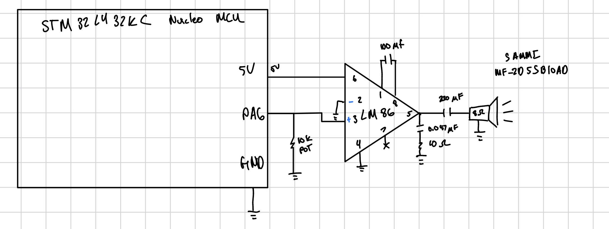

## Overview

The STM32L432KC plays the provided *Für Elise* score through an LM386 amplifier and an 8 $\Omega$ speaker. TIM16 generates each square-wave pitch on PA6, while TIM6 measures note and rest durations.

**Result:** The design plays the supplied song at the specified pitches and durations, including rests. A 10 k$\Omega$ potentiometer controls the volume.

**Source code:** [E155 Lab 4 GitHub repository](YOUR_GITHUB_REPOSITORY_URL)

## Hardware

### Circuit

{#fig-schematic width=100% fig-align="center"}

The complete on-board design is available in the [E155 Development Board schematic](https://hmc-e155.github.io/assets/doc/E155%20FA22%20Development%20Board%20Schematic.pdf).

However, for this lab, the MCU was placed directly onto the breadboard not using the development board. The LM386 amplifier was connected to the MCU and a potentiometer was added to control the volume.

## Software and MCU Design

### Program flow

1. Configure flash latency for an 80 MHz system clock.
2. Configure the PLL for an 80 MHz clock.
3. configure PA6 for alternate function 14 (`TIM16_CH1`).
4. Configure TIM16 for PWM pitch generation.
5. Configure TIM6 as a 1 ms duration timer.
6. Read each `{frequency, duration}` pair from the supplied score.
7. Generate the pitch or disable the output for a rest.
8. Stop when a duration of zero is encountered.

The implementation uses manually defined base addresses, register structures, and bit masks. It does not use the STM32 CMSIS device header.

### Clock configuration

The 4 MHz MSI clock is multiplied by the PLL:

$$
f_{SYS}=f_{MSI}\left(\frac{N}{M}\right)\frac{1}{R}
$$

$$
f_{SYS}=4\text{ MHz}\left(\frac{40}{1}\right)\frac{1}{2}
=80\text{ MHz}
$$

### Timer configuration

Both timers use `PSC = 79`:

$$
f_{\text{counter}}
=
\frac{f_{\text{timer input}}}{PSC+1}
=
\frac{80\text{ MHz}}{79+1}
=
1\text{ MHz}
$$

Each timer count therefore lasts 1 $\mu$s.

TIM6 uses `ARR = 999`:

$$
T_{update}=\frac{ARR+1}{1\text{ MHz}}
=\frac{1000}{1\text{ MHz}}
=1\text{ ms}
$$

A duration of $D$ milliseconds is generated by waiting for $D$ TIM6 update events.

### Pitch calculations

For a desired frequency $f_d$:

$$
N=\left\lfloor\frac{1{,}000{,}000}{f_d}\right\rfloor,
\qquad ARR=N-1,
\qquad CCR1=\left\lfloor\frac{N}{2}\right\rfloor
$$

The resulting pitch is:

$$
f_a=\frac{1{,}000{,}000}{ARR+1}
$$

| Desired pitch | $N$ | `ARR` | `CCR1` | Actual pitch | Error |
|---:|---:|---:|---:|---:|---:|
| 220 Hz | 4545 | 4544 | 2272 | 220.022 Hz | 0.010% |
| 1000 Hz | 1000 | 999 | 500 | 1000.000 Hz | 0.000% |

Example for 220 Hz:

$$
N=\left\lfloor\frac{1{,}000{,}000}{220}\right\rfloor=4545
$$

$$
ARR=4545-1=4544
$$

$$
f_a=\frac{1{,}000{,}000}{4545}=220.022\text{ Hz}
$$

$$
\%\text{ error}=\frac{|220.022-220|}{220}\times100\%=0.010\%
$$

### Accuracy of all notes

For every nonzero score frequency at or below 1000 Hz, the period contains at least 1000 timer counts. Truncation changes the calculated period by less than one count, so the frequency error is bounded by:

$$
\%\text{ error}<\frac{1}{1000}\times100\%=0.1\%
$$

Therefore, all nonzero notes in the supplied *Für Elise* score can be reproduced within the required 1% accuracy. Testing 220 Hz and 1000 Hz alone is not a mathematical proof; the timer-resolution bound supplies the proof for the intermediate frequencies.

### Supported limits

TIM16 has a 16-bit auto-reload register. With the fixed 1 MHz timer clock:

$$
f_{min}=\frac{1{,}000{,}000}{65{,}536}=15.26\text{ Hz}
$$

A meaningful 50% duty-cycle waveform requires at least two timer counts:

$$
f_{max}=\frac{1{,}000{,}000}{2}=500\text{ kHz}
$$

The delay function has 1 ms resolution:

$$
D_{min}=1\text{ ms}
$$

For its `uint32_t` argument:

$$
D_{max}=2^{32}-1\text{ ms}=49.71\text{ days}
$$

The signed `int` score array limits a stored positive duration to approximately 24.86 days.

## Verification

### Pitch measurements

| Requested | Measured | Percent error | Requirement |
|---:|---:|---:|---:|
| 220 Hz | 220 Hz | 0.0% | $<1\%$ |
| 1000 Hz | 995 Hz | 0.5% | $<1\%$ |

The measured frequencies satisfy the 1% requirement.

### Accuracy of all notes

The actual frequency and percent error were calculated for every unique nonzero pitch in the supplied *Für Elise* score.

| Desired frequency | Actual frequency | Percent error |
|---:|---:|---:|
| 262 Hz | 262.055 Hz | 0.0208% |
| 330 Hz | 330.033 Hz | 0.0100% |
| 349 Hz | 349.040 Hz | 0.0115% |
| 392 Hz | 392.003 Hz | 0.0008% |
| 416 Hz | 416.146 Hz | 0.0352% |
| 440 Hz | 440.141 Hz | 0.0320% |
| 494 Hz | 494.071 Hz | 0.0144% |
| 523 Hz | 523.013 Hz | 0.0024% |
| 587 Hz | 587.199 Hz | 0.0339% |
| 623 Hz | 623.053 Hz | 0.0085% |
| 659 Hz | 659.196 Hz | 0.0297% |
| 699 Hz | 699.301 Hz | 0.0430% |
| 1,319 Hz | 1,319.261 Hz | 0.0198% |

The largest calculated error is:

$$
\boxed{0.0430\%}
$$

All supplied pitches are within the required 1% error. Checking only 220 Hz and 1000 Hz does not prove this because integer truncation produces a different error for each requested frequency. The complete table verifies every unique pitch in the score.

### Functional tests

| Test | Result |
|---|---|
| Plays provided *Für Elise* score | Pass |
| Correct note ordering | Pass |
| Correct note durations | Pass |
| Frequency-zero rests produce silence | Pass |
| Duration-zero entry ends playback | Pass |
| LM386 drives the 8 $\Omega$ speaker | Pass |
| Potentiometer changes volume | Pass |

<!-- Add images/lab4-demo.mp4 or a hosted demo link here. -->

## Requirements Summary

| Requirement | Status |
|---|---|
| Für Elise playback | Met |
| Correct tempo and rests | Met |
| LM386 amplifier and 8 $\Omega$ speaker | Met |
| Timer accessed through memory-mapped registers | Met |
| Manually defined register macros and structures | Met |
| 220 Hz and 1000 Hz within 1% | Met |
| Volume-control potentiometer | Met |
| Supported frequency/duration limits documented | Met |
| All score frequencies proven within 1% | Met |
| Extra composition | Twinkle Twinkle Little Star |

## AI Prototype and Reflection

### AI Prototype Prompt

> Create register-level STM32L432KC timer code that uses TIM16 to generate pitches on PA6 and TIM6 to control note durations and rests.

AI was used to prototype the timer structure and identify edge cases in pitch generation. The prototype suggested separating pitch generation and note timing between TIM16 and TIM6. It also highlighted the need to handle `frequency == 0` before the division used to calculate `ARR`, preventing division by zero during rests. The final register addresses, bit fields, calculations, wiring, and measured behavior were checked against the STM32 and LM386 documentation and verified on the physical system.

## Time Spent

**Total:** `20` hours

## References

- [Lab 4: Digital Audio](https://hmc-e155.github.io/lab/lab4/)
- [Lab 4 Specifications](https://hmc-e155.github.io/lab/lab4/specs.html)
- [Texas Instruments LM386 Datasheet](https://www.ti.com/lit/ds/symlink/lm386.pdf)
- [E155 Development Board Schematic](https://hmc-e155.github.io/assets/doc/E155%20FA22%20Development%20Board%20Schematic.pdf)

