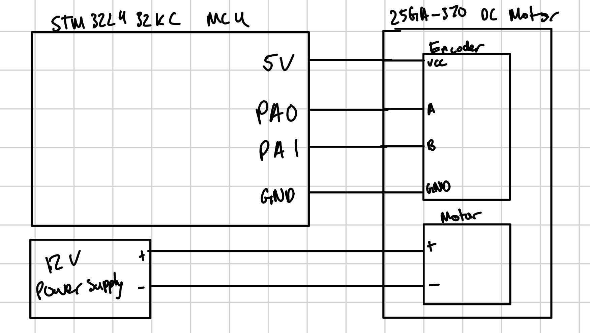
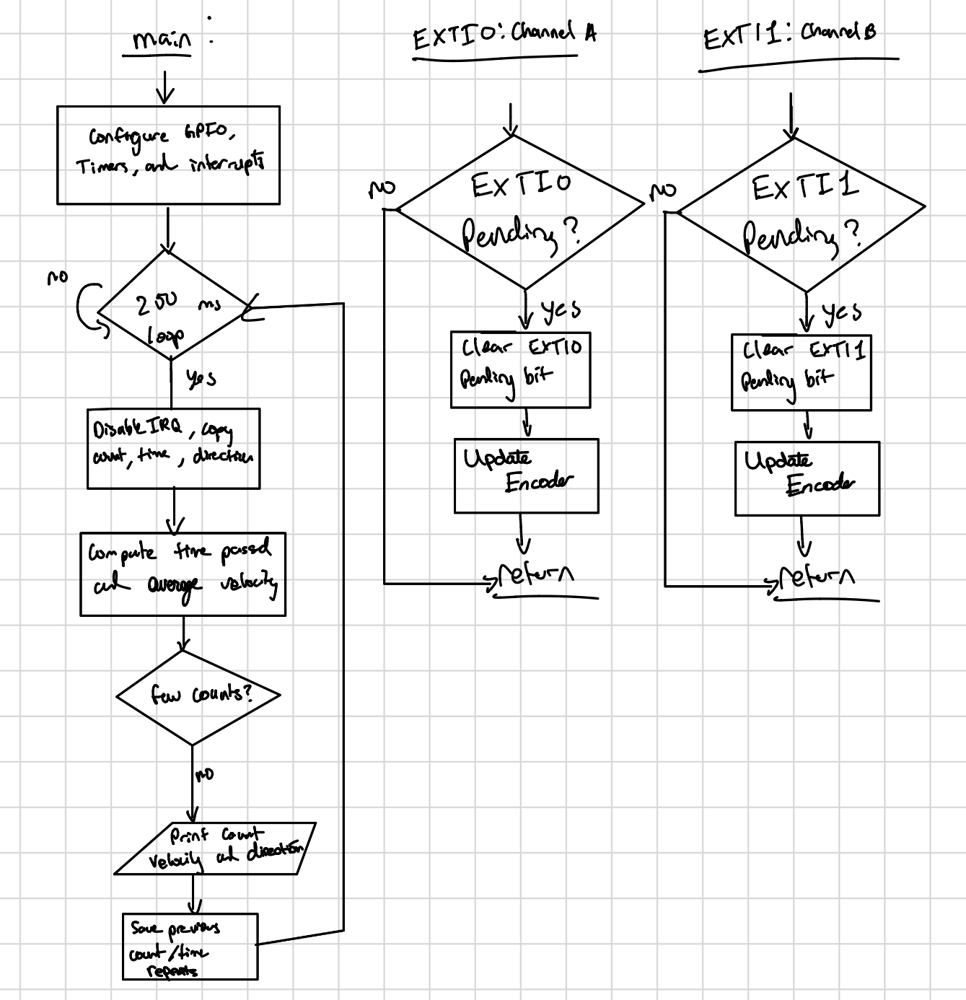

## Circuit


{width=90%}

## Program Flow

{width=100%}

TIM2 counts microseconds. Both rising and falling edges of encoder channels A and B trigger interrupts.

## Calculations

Both edges of both encoder channels are counted:

$$
N = 408 \times 4 = 1632\text{ counts/rev}.
$$

**Angular resolution:**

$$
\Delta\theta = \frac{360^\circ}{1632}
= 0.221^\circ/\text{count}.
$$

**Update rate:**

$$
f_{\text{report}} = \frac{1}{0.250}
= 4\text{ Hz}.
$$

**Velocity:** For count change $\Delta C$ over elapsed time $\Delta t$ in seconds,

$$
v = \frac{\Delta C}{1632\Delta t}.
$$

Approximately 46,000 counts over 10 seconds gives

$$
v = \frac{46{,}000}{1632(10)}
\approx 2.82\text{ rev/s}.
$$

**Velocity resolution:** One count in a 250 ms window corresponds to

$$
\Delta v = \frac{1}{1632(0.250)}
\approx 0.00245\text{ rev/s}.
$$

**Low-speed estimate:** Using the interval between consecutive same-direction edges,

$$
|v| = \frac{10^6}{1632T_{\text{edge}}}\text{ rev/s},
$$

where $T_{\text{edge}}$ is in microseconds.

**Direction:** The order of changes in channels A and B determines whether the encoder count increases or decreases.

## Results

| Test | Observation |
|---|---|
| Motor stopped | Count remained constant and terminal reported 0.000 rev/s |
| Shaft turned forward by hand | Encoder count increased |
| Shaft turned backward by hand | Encoder count decreased |
| One manual revolution | Approximately 1600 counts |
| Motor powered at 12 V | Approximately 2.8 rev/s |
| Visual speed measurement | Approximately 3.0 rev/s |
| Terminal update rate | Approximately 4 updates/s |
| Both encoder channels | Rising and falling edges enabled |

<details>
<summary>Terminal output and measured results</summary>

| Test condition | Terminal result |
|---|---|
| Motor stopped | Velocity: 0.000 rev/s |
| Shaft turned forward | Count increased |
| Shaft turned backward | Count decreased |
| Motor powered at 12 V | Approximately 2.8 rev/s |
| Ten-second powered test | Approximately 46,000 counts |
| Reporting rate | Approximately 4 updates per second |

</details>

</details>

## Interrupts Compared with Polling

Approximately 46,000 encoder transitions were counted in 10 seconds:

$$
f_{\text{edge}} = \frac{46{,}000}{10}
= 4600\text{ transitions/s}.
$$

The average time between transitions was

$$
T_{\text{edge}} = \frac{10^6}{4600}
\approx217\ \mu\text{s}.
$$

A polling interval of 100 μs would require 10,000 pin checks per second, compared with approximately 4,600 encoder interrupts per second at this speed. Polling repeatedly checks the inputs even when nothing changes; interrupts require processing only when an edge occurs.

Polling must remain faster than the shortest edge interval, including time spent calculating and printing. Interrupts allow encoder counting to continue during those main-loop operations, provided interrupt latency and processing time are short enough.

This is a calculated comparison; a separate polling implementation was not tested. The 217 μs value is an average and does not guarantee that a particular polling interval captures every edge.

## AI Prototype and Reflection

**Prompt:** “Write a C function that determines a quadrature encoder’s direction and updates a signed count using its previous and current A/B states. Count both rising and falling edges of both channels, and explain how the function handles unexpected signal changes.”

Store A in bit 1 and B in bit 0. Call this function with the current state whenever either channel changes. Initialize `previous` to the actual encoder state before enabling interrupts.

```c
#include <stdint.h>

static uint8_t previous;
volatile int32_t prototype_count = 0;

void processEncoderState(uint8_t current) {
    // Rows represent the previous state;
    // columns represent the current state.
    static const int8_t steps[16] = {
         0,  1, -1,  0,
        -1,  0,  0,  1,
         1,  0,  0, -1,
         0, -1,  1,  0
    };

    current &= 3U;
    uint8_t index = (previous << 2) | current;

    prototype_count += steps[index];
    previous = current;
}
```

Each valid transition adds or subtracts one count. Unchanged states and two-bit jumps contribute zero. After an invalid transition, the function resynchronizes to the current state; it cannot recover missed counts. The positive direction depends on the channel wiring.

</details>

**Reflection:** I asked AI to generate an alternative direction decoder using a lookup table. It produced a compact function that handles forward, reverse, unchanged, and invalid transitions. The response also identified the need to initialize the previous state before enabling interrupts. However, this function alone does not configure interrupts or calculate velocity. I preferred explicit `if/else` statements in my final project because they were easier to explain line by line. This separate prototype was reviewed but not hardware-tested.

## Completion

- **Time spent:** 12