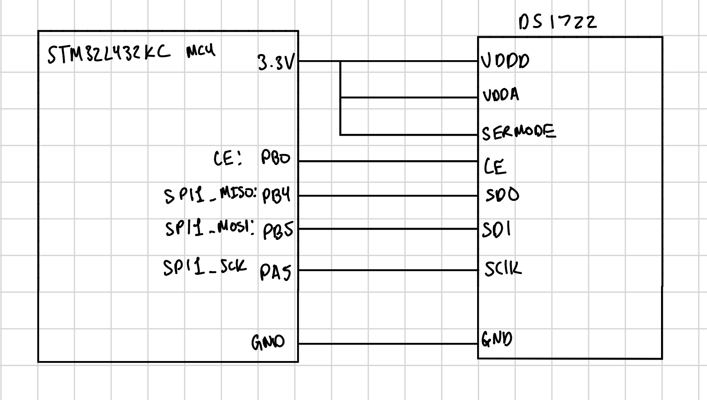
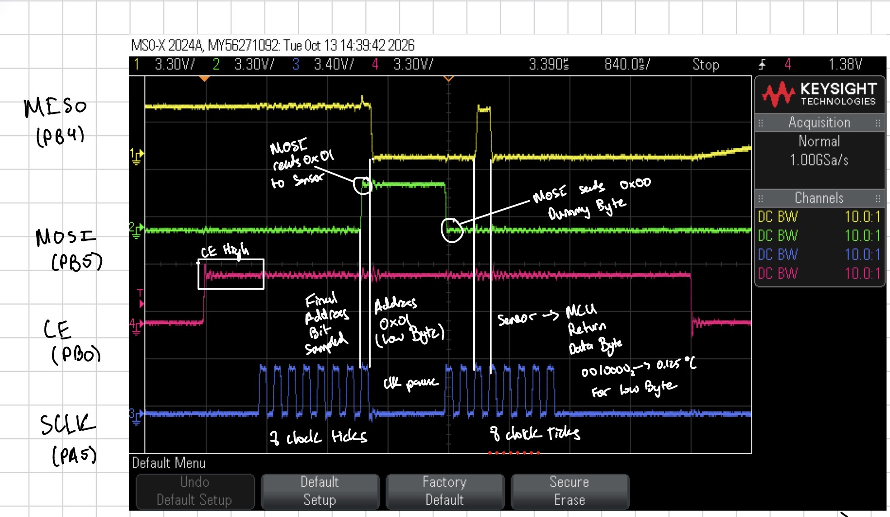

## Introduction

This lab connects an STM32L432KC microcontroller, a DS1722 temperature sensor, and an ESP8266 Wi-Fi module to create a browser-controlled temperature monitor. The STM32 reads the sensor through a CMSIS-based SPI driver and communicates with the ESP8266 over UART. The webpage provides temperature information and controls for the onboard LED.

## Design and Testing Methodology

SPI1 uses PA5 for SCLK, PB4 for MISO, and PB5 for MOSI. PB0 controls the DS1722's active-high chip enable. The interface uses eight-bit transfers with CPOL = 0 and CPHA = 1, so SCLK idles low and data is sampled on falling edges.

The sensor is configured for continuous 12-bit measurements. Each temperature request reads the LSB and MSB registers in separate transactions. CE stays high while an address and a dummy byte are transmitted, then returns low after the transfer finishes.

## Technical Documentation

The portfolio and lab documentation are available in my [GitHub repository](https://github.com/bphung-01/hmc-e155-portfolio).

### Schematic

<details>
<summary>Expand to see schematic</summary>

{#fig-schematic width=90%}

</details>

The DS1722's VDDD, VDDA, and SERMODE pins connect to 3.3 V, and its ground connects to the MCU ground. SERMODE selects SPI operation. CE connects to PB0, SCLK to PA5, SDO to PB4, and SDI to PB5.

The ESP8266 Click module is installed in the motherboard's mikroBUS socket. The onboard MCU, LED, and socket connections are documented in the [development-board schematic](https://hmc-e155.github.io/assets/doc/E155%20Development%20Board%20Schematic.pdf). The FPGA–MCU DIP switches are kept open to prevent interference on shared pins.

### Calculations

**SPI clock:**

With the baud-rate field set to 3, the clock divider is

$$
D=2^{3+1}=16.
$$

Therefore,

$$
f_{\mathrm{SCLK}}=\frac{f_{\mathrm{SPI1}}}{16}.
$$

For an 80 MHz SPI1 peripheral clock,

$$
f_{\mathrm{SCLK}}=5\text{ MHz},
\qquad
T_{\mathrm{SCLK}}=200\text{ ns}.
$$

**Temperature conversion:**

The received bytes are combined into a signed 16-bit value:

$$
T=\frac{\operatorname{int16}(256\,\mathrm{MSB}+\mathrm{LSB})}{256}.
$$

For example, an MSB of `0x19` and LSB of `0x20` give

$$
T=\frac{25(256)+32}{256}
=25.125^\circ\text{C}.
$$


**Resolution and signed range:**

The 12-bit setting provides increments of

$$
\Delta T=\frac{1}{16}=0.0625^\circ\text{C}.
$$

Signed decoding supports the required endpoints:

$$
\texttt{0xF600}\rightarrow -2560/256=-10^\circ\text{C},
$$

$$
\texttt{0x1E00}\rightarrow 7680/256=30^\circ\text{C}.
$$

### Oscilloscope Trace

<details>
<summary>Expand to see SPI read trace</summary>

{#fig-spi width=100%}

</details>

### SPI Read Transaction

The oscilloscope capture shows one complete read of the DS1722 temperature low-byte register. From top to bottom, the traces are **MISO** (yellow, CH1), **MOSI** (green, CH2), **CE** (pink, CH4), and **SCLK** (blue, CH3). MOSI connects STM32 pin PB5 to the sensor's SDI input, while MISO connects the sensor's SDO output to STM32 pin PB4. PB0 controls CE, and PA5 supplies SCLK.

**Address transfer.** The transaction begins when the STM32 raises CE. The DS1722 uses an active-high chip enable, so CE remains high throughout both clock bursts. During the first eight clocks, the STM32 transmits the register address `00000001` (`0x01`) on MOSI, most significant bit first. This address selects the temperature low-byte register. The SPI interface uses CPOL = 0 and CPHA = 1: SCLK is low when idle, data changes on rising edges, and the receiving device samples data on falling edges. MOSI therefore rises for the final address bit, and the sensor samples that `1` on the eighth falling edge.

**Pause between bytes.** After the address byte, SCLK briefly stops while the STM32 finishes the first byte-transfer function and prepares the next transfer. CE stays high, so the sensor remains selected. MOSI holds the final address bit at a high level during this pause. This does not transmit additional ones because no sampling edges occur while the clock is stopped.

**Data transfer.** During the second eight-clock burst, the STM32 sends a dummy byte of `0x00` on MOSI. Sending this byte generates the clocks needed for the sensor to return its data on MISO. The STM32 samples MISO on each falling edge, and its SPI hardware assembles the received bits into a byte. The returned bit pattern in this capture appears to be `00100000`, or `0x20`.

The initial high MISO level before the response is not temperature data. During the address phase, the DS1722 output is high impedance, meaning the sensor is not actively driving the line. A high voltage during that interval cannot be interpreted as a valid transmitted bit. Only the response during the second clock burst is decoded.

**Temperature interpretation.** The low byte contributes the fractional portion of the temperature encoding. For the observed value:

$$
\frac{\texttt{0x20}}{256}
=
\frac{32}{256}
=
0.125^\circ\mathrm{C}.
$$

This capture alone does not establish the complete temperature. The program reads the high-byte register at address `0x02` in a separate transaction, then combines the two bytes into a signed 16-bit value:

$$
T =
\frac{\operatorname{int16}\left(256\,\mathrm{MSB}+\mathrm{LSB}\right)}
{256}.
$$

For example, a high byte of `0x16` combined with the captured low byte of `0x20` would represent 22.125°C. This is an illustrative calculation; the high byte is not shown in this capture. The driver performs separate transactions because its register-read function reads one byte at a time. Each transaction contains eight address clocks and eight data clocks, regardless of the sensor's selected measurement resolution.

**Timing comparison.** Using the screenshot's horizontal scale of 840 ns per division, the interval between consecutive rising edges within a clock burst is approximately 200 ns. One clock cycle transfers one bit, so the estimated bit period and clock frequency are:

$$
T_{\mathrm{bit}} \approx 200\ \mathrm{ns},
\qquad
f_{\mathrm{SCLK}} =
\frac{1}{T_{\mathrm{bit}}}
\approx 5\ \mathrm{MHz}.
$$

The clock's high and low intervals appear approximately equal, indicating a duty cycle near 50%. The estimated frequency is consistent with operation near the DS1722's specified maximum of 5 MHz.

After the final data bit has been received and the SPI transfer has finished, the STM32 lowers CE to end the transaction.

</details>

## Results and Discussion

| Test | Observation |
|---|---|
| Wi-Fi connection | The replacement ESP8266 module allowed webpage access |
| LED control | Browser commands switched the LED on and off |
| Temperature requests | LED commands requested a new temperature display |
| SPI read | CE enclosed an eight-bit address and eight-bit response |
| Address decoding | The captured address appeared to be `0x01` |
| Response decoding | The captured LSB appeared to be `0x20` |

## Conclusion

This lab demonstrated SPI communication between the STM32L432KC and DS1722 and UART communication with the ESP8266. The webpage displays temperature, controls the LED, and allows selection of 8–12-bit sensor resolution. The annotated oscilloscope capture shows a complete register-read transaction with an estimated 200 ns bit period, corresponding to approximately 5 MHz. Debugging the request handling and temperature formatting helped distinguish sensor configuration from how readings are displayed.

**Hours spent on lab:** [15]

## AI Prototype Summary

AI assistance was used to answer this prompt: 

Write a C function that uses my existing readDS1722() function to read the temperature’s low and high bytes, combine them into a signed 16-bit value, and return the temperature in degrees Celsius.

<details>
<summary>AI-assisted temperature conversion code</summary>

```c
float readTemperature(void) {
    uint8_t lsb = readDS1722(DS1722_TEMP_LSB);
    uint8_t msb = readDS1722(DS1722_TEMP_MSB);

    int16_t rawTemperature =
        (int16_t)(((uint16_t)msb << 8) | (uint16_t)lsb);

    return rawTemperature / 256.0f;
}
```

</details>

**Reflection:** AI helped me write a function that reads the DS1722’s low and high temperature bytes, combines them into a signed 16-bit value, and converts the result to degrees Celsius. Its explanation helped me understand why the high byte is shifted left by eight bits and why the combined value is divided by 256. Using a signed value also allows the function to handle negative temperatures.

The generated code was straightforward because it used my existing readDS1722() function. However, it still depended on the SPI driver and wiring working correctly. I found AI useful for explaining the conversion and organizing the code, while checking the datasheet and observing the hardware remained necessary to verify the result.

## References

- [Lab 6 specifications](https://hmc-e155.github.io/lab/lab6/specs.html)
- [Lab 6 instructions](https://hmc-e155.github.io/lab/lab6/)
- [Lab 6 AI prototype](https://hmc-e155.github.io/lab/lab6/ai-prototype.html)
- [DS1722 datasheet](https://www.analog.com/media/en/technical-documentation/data-sheets/DS1722.pdf)