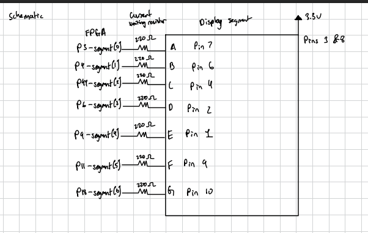
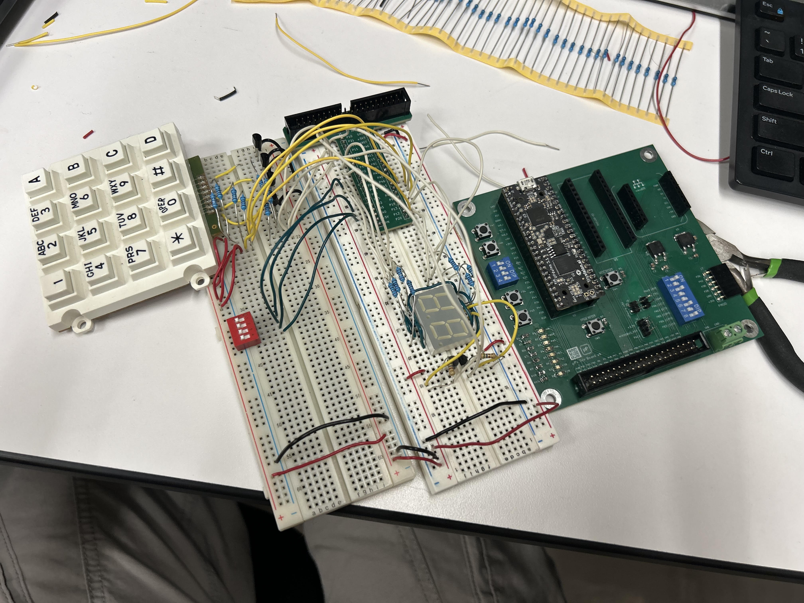
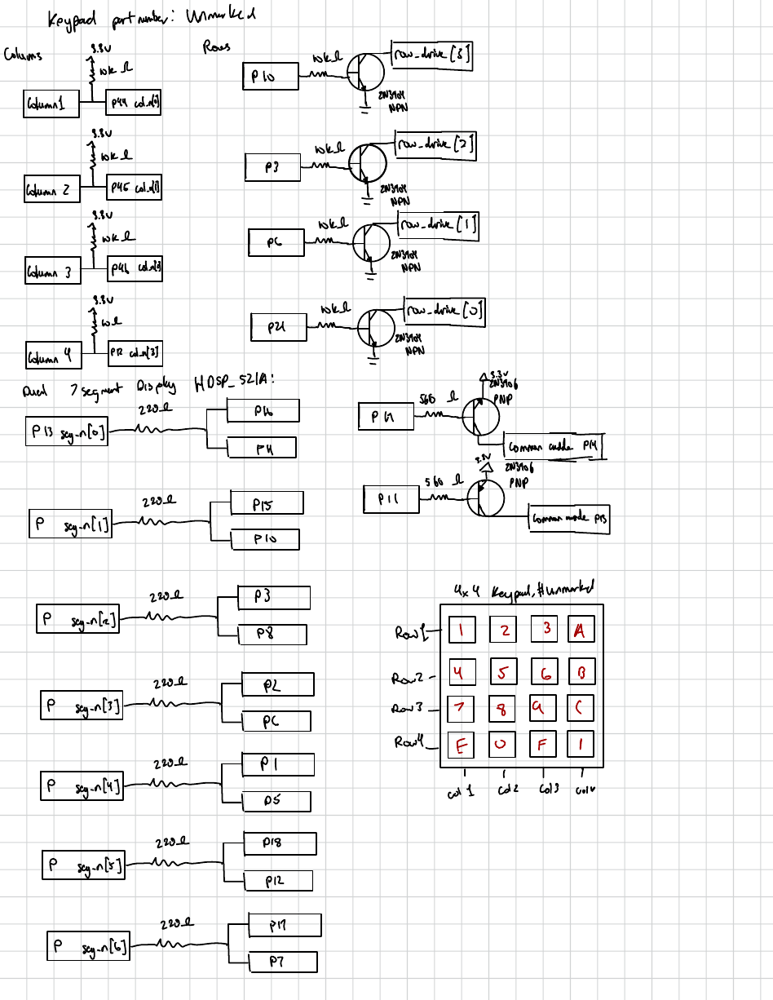
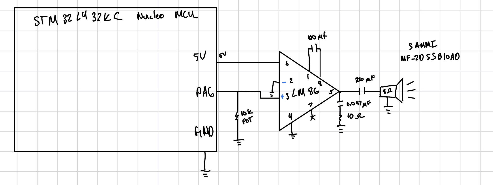
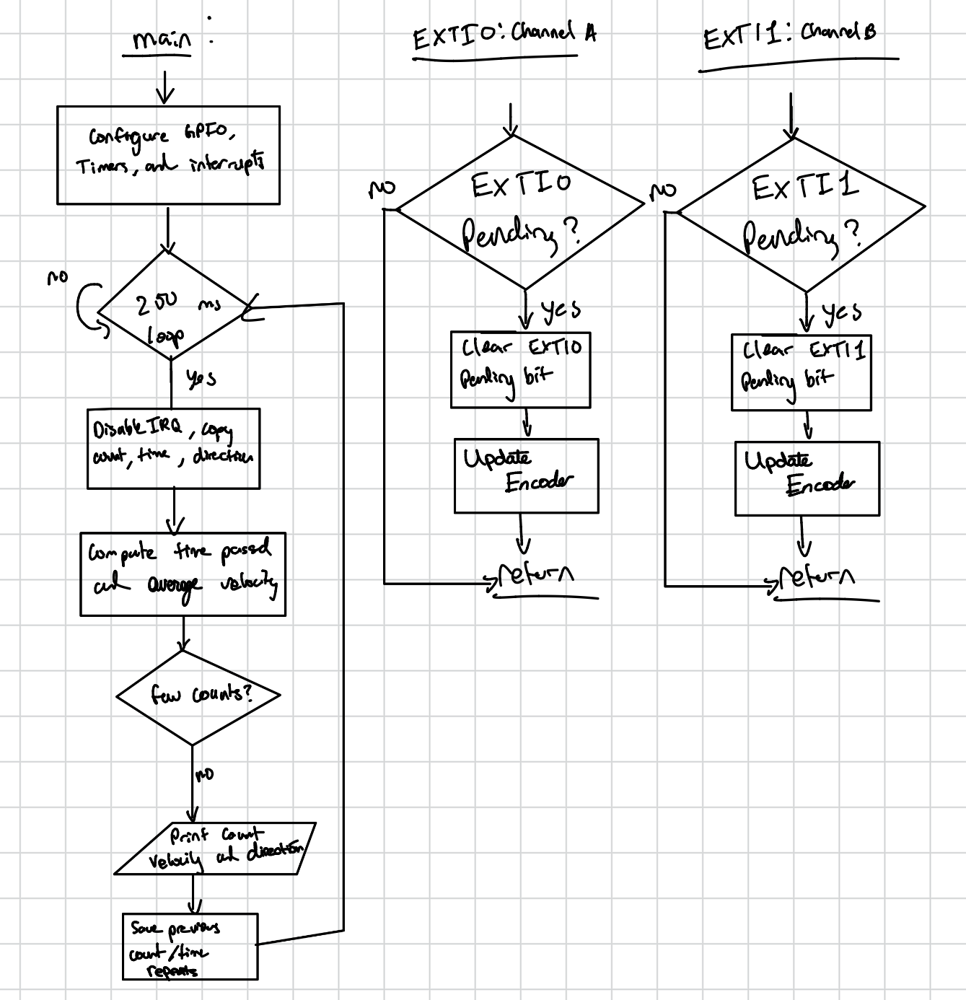
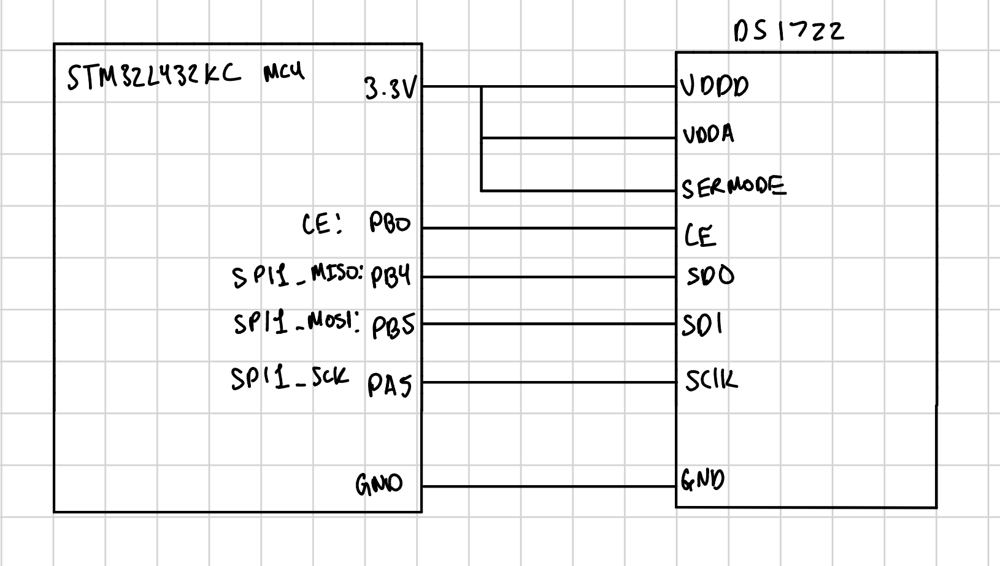

These reports document design choices, simulation, hardware results, and open checks from E155 at Harvey Mudd College.

```{=html}
<div class="card-grid">
  <a class="work-card" href="labs/lab1/lab1.html"><div class="thumb thumb-contain"></div><div class="card-body"><span class="tag">Lab 01 · FPGA</span><h3>FPGA and Board Testing</h3><p>Switches select a hexadecimal digit while the FPGA drives a seven-segment display, LED logic, and a blink counter.</p></div></a>
  <a class="work-card" href="labs/lab2/lab2.html"><div class="thumb"></div><div class="card-body"><span class="tag">Lab 02 · Digital logic</span><h3>Multiplexed Seven-Segment Display</h3><p>A shared decoder drives two hexadecimal digits, and a basic keypad scanner shows keypresses on LEDs.</p></div></a>
  <a class="work-card" href="labs/lab3/lab3.html"><div class="thumb thumb-contain"></div><div class="card-body"><span class="tag">Lab 03 · FPGA</span><h3>Keypad Scanner</h3><p>A 4 × 4 keypad scanner combines synchronized inputs, debouncing, and controller logic.</p></div></a>
  <a class="work-card" href="labs/lab4/lab4.html"><div class="thumb thumb-contain"></div><div class="card-body"><span class="tag">Lab 04 · STM32</span><h3>Digital Audio</h3><p>Hardware timers play <em>Für Elise</em> through an LM386 amplifier, with pitch checks and volume control.</p></div></a>
  <a class="work-card" href="labs/lab5/lab5.html"><div class="thumb thumb-contain"></div><div class="card-body"><span class="tag">Lab 05 · Interrupts</span><h3>Motor Velocity with Encoder Interrupts</h3><p>Encoder interrupts track shaft direction and position; a timer turns counts into a velocity estimate.</p></div></a>
  <a class="work-card" href="labs/lab6/lab6.html"><div class="thumb thumb-contain"></div><div class="card-body"><span class="tag">Lab 06 · SPI + IoT</span><h3>SPI and the Internet of Things</h3><p>An STM32 reads a DS1722 over SPI and uses an ESP8266 for local temperature display and LED control.</p></div></a>
</div>
```

## Course Project

My [laser tag system](projects.qmd#laser-tag-system) extends this work with an STM32, FPGA, custom PCB, IR blasters and receivers, and a local Wi-Fi scoreboard. The system is in development.
