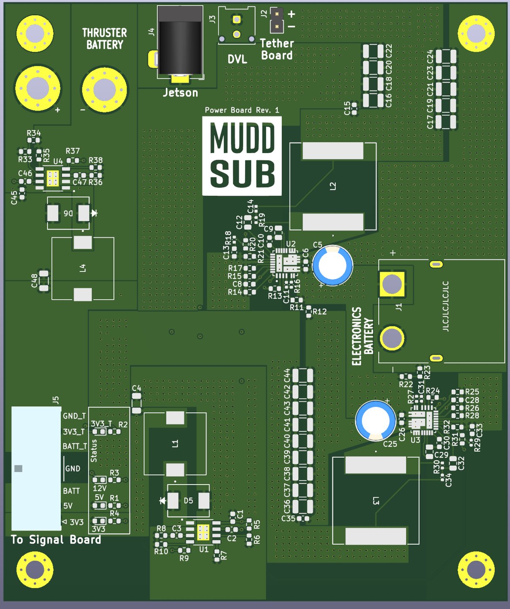
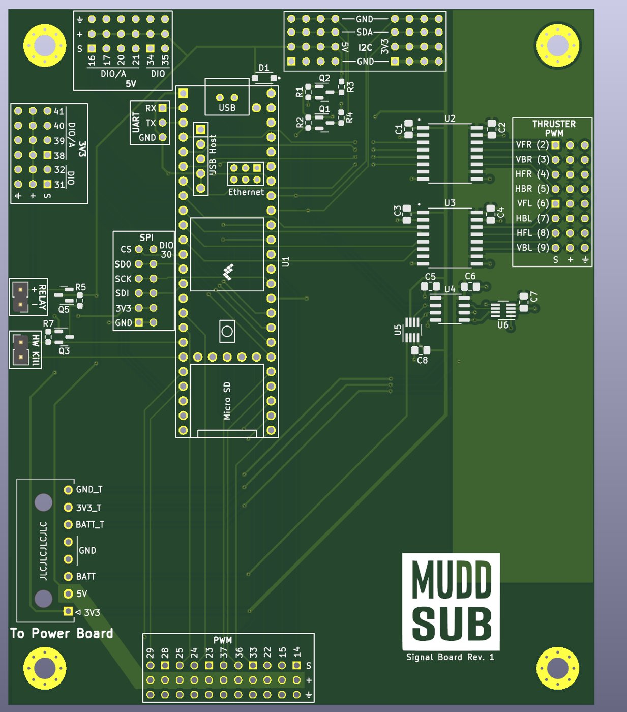

[← Back to all projects](projects.qmd)

```{=html}
<section class="project-overview muddsub-overview" aria-label="MuddSub project overview">
  <div class="project-overview-media muddsub-overview-media">
    
  </div>
  <div class="project-overview-body">
    <span class="tag">MuddSub · PCB team · Ongoing</span>
    <p><strong>Project</strong><br>
    Develop the electrical backbone for Alfie, Harvey Mudd College's student-built autonomous underwater vehicle for the international RoboSub competition.</p>
    <p><strong>My role</strong><br>
    Contribute to PCB design and verification as a member of the electrical team, along with chassis packaging, waterproofing, buoyancy, and system integration.</p>
    <p><strong>Engineering areas</strong><br>
    KiCad and Altium PCB design, power distribution, embedded interfaces, board bring-up, bench validation, and underwater hardware integration.</p>
    <div class="project-links">
      <a class="action action-primary" href="https://muddsub.org/" target="_blank" rel="noopener">MuddSub Website</a>
      <a class="action action-outline" href="experience.html#muddsub">Experience</a>
    </div>
  </div>
</section>
```

::: {.project-facts}
<div><span>Vehicle</span><strong>8-thruster AUV</strong></div>
<div><span>Power rails</span><strong>12 V · 5 V · 3.3 V</strong></div>
<div><span>Controller</span><strong>Teensy 4.1</strong></div>
<div><span>Status</span><strong>Design + verification</strong></div>
:::

## The vehicle

MuddSub is Harvey Mudd College's student-run autonomous underwater robotics team. The team designs and builds **Alfie**, an AUV intended to perceive its environment, navigate independently, and complete RoboSub competition tasks.

That mission makes the electrical system a tightly coupled part of the vehicle. Power electronics must support propulsion and compute loads; the signal architecture must connect sensors, thrusters, and higher-level autonomy; and every board must fit inside a pressure-conscious, serviceable mechanical package.

## Rev. 1 power and signal boards

::: {.muddsub-board-gallery}
::: {.muddsub-board}
{#fig-muddsub-power fig-alt="MuddSub Power Board Revision 1 render"}

**Power Board Rev. 1.** Distributes energy from separate thruster and electronics batteries and generates regulated rails for vehicle compute, navigation, tether, and control hardware.
:::

::: {.muddsub-board}
{#fig-muddsub-signal fig-alt="MuddSub Signal Board Revision 1 render"}

**Signal Board Rev. 1.** Centers the real-time interfaces around a Teensy 4.1, with thruster PWM and breakouts for the serial buses used across the vehicle.
:::
:::

These are team-designed boards. My work as a PCB team member includes helping turn subsystem requirements into reviewable schematics and layouts, checking interfaces between boards, and supporting verification before the electronics are sealed inside the vehicle.

## Electrical architecture

```{mermaid}
flowchart LR
  TB[Thruster battery] --> PWR[Power board]
  EB[Electronics battery] --> PWR
  PWR --> R12[12 V rail]
  PWR --> R5[5 V rail]
  PWR --> R33[3.3 V rail]
  R12 --> JET[Jetson compute]
  R5 --> DVL[DVL + peripherals]
  R33 --> SIG[Signal board]
  SIG --> PWM[8-channel thruster PWM]
  SIG --> BUS[I²C · SPI · UART]
  PWM --> THR[Thrusters]
```

The **power board** accepts independent propulsion and electronics battery inputs. Switching regulators create the voltage rails needed by the Jetson computer, Doppler velocity log, tether hardware, and signal electronics. Keeping these loads organized on a common board simplifies distribution while making rail status and inter-board connections easier to inspect.

The **signal board** provides the low-level connection between the vehicle computer and physical hardware. A Teensy 4.1 produces PWM commands for eight thrusters and exposes I²C, SPI, UART, digital I/O, relay, and hardware-kill connections for vehicle subsystems.

## My contributions

### PCB design and review

I contribute to translating system-level needs into board requirements, reviewing schematics and layouts, and checking connector pinouts and power assumptions across the electrical stack. The goal is not only a board that routes successfully, but a board the team can assemble, probe, debug, and revise.

### Bring-up and verification

My validation work is organized around staged bring-up: inspect assembly and continuity first, apply current-limited power, verify each regulated rail, then add the controller and connected subsystems. Signal-board checks include programmed PWM outputs, serial-bus connectivity, connector mapping, and safe behavior through the hardware-kill path.

### Vehicle integration

I also contribute outside the PCB boundary. Chassis layout, waterproofing, buoyancy, connector access, cable routing, and serviceability all affect whether the electronics can operate reliably underwater. Those mechanical constraints feed back into board shape, mounting-hole placement, connector orientation, and test access.

## Verification approach

| Area | What we check | Why it matters |
|---|---|---|
| Power entry | Polarity, continuity, protection, and current-limited startup | Prevents a wiring or assembly error from damaging the full stack |
| Regulated rails | 12 V, 5 V, and 3.3 V output level, ripple, and behavior under load | Confirms compute, sensor, and control hardware receive stable power |
| Thruster control | PWM timing and channel mapping across all eight outputs | Ensures software commands reach the intended thruster |
| Digital interfaces | I²C, SPI, UART, and GPIO continuity and communication | Verifies sensors and peripheral boards can exchange data |
| Safety path | Relay and hardware-kill behavior | Provides a hardware-level way to stop propulsion |
| Integration | Fit, mounting, cable access, thermal behavior, and enclosure interfaces | Connects successful bench behavior to reliable operation in the vehicle |

## Current stage

The Rev. 1 renders document the present board architecture. Fabrication, bring-up, load testing, vehicle integration, and subsequent revisions are part of the continuing process; the page will evolve as measured results replace design intent.

```{=html}
<div class="project-links project-links-bottom">
  <a class="action action-primary" href="https://muddsub.org/" target="_blank" rel="noopener">Visit MuddSub</a>
  <a class="action action-outline" href="projects.html">All Projects</a>
</div>
```
