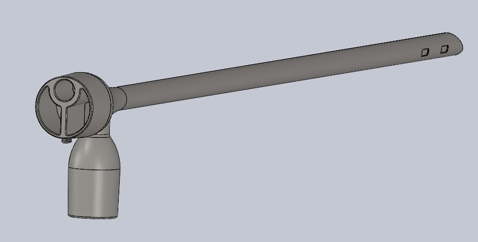
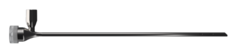

[← Back to all projects](projects.qmd)

```{=html}
<section class="project-overview" aria-label="Project overview">
  <div class="project-overview-media bronchoscope-hero-media">
    
  </div>
  <div class="project-overview-body">
    <span class="tag">Partnerships for Global Surgery · Sponsored engineering project</span>
    <p><strong>Project brief</strong><br>
    Develop an affordable, durable pediatric rigid bronchoscopy system for foreign-body removal in resource-constrained clinical settings.</p>
    <p><strong>My focus</strong><br>
    Distal-camera selection and integration, endoscope heat testing, camera-cleaning concepts, and handle ideation.</p>
    <p><strong>Engineering areas</strong><br>
    Medical-device design, miniature optics, thermal testing, prototyping, design for cleaning, and verification planning.</p>
  </div>
</section>
```

::: {.project-facts}
<div><span>Camera diameter</span><strong>2.0 mm</strong></div>
<div><span>Video output</span><strong>720 × 720 at 30 fps</strong></div>
<div><span>Bronchoscope OD</span><strong>5.7 mm</strong></div>
<div><span>Development status</span><strong>In progress</strong></div>
:::

::: {.callout-warning}
## Work in progress

This page documents an active **Harvey Mudd Engineering Clinic** project. The hardware shown is developmental, the specifications below are design targets or preliminary observations, and the system has **not** completed verification or clinical validation. Spring work will focus on manufacturing, iteration, and simulated-use testing.
:::

## Sponsored project context

This is a sponsored engineering project with **Partnerships for Global Surgery**, developed by a seven-person Harvey Mudd Engineering Clinic team in collaboration with clinical and engineering advisors. The project responds to the cost, fragility, maintenance, training, and supply-chain barriers that can limit access to pediatric rigid bronchoscopy equipment.

The team is designing for pediatric patients from approximately **9 months to 6 years old**. Affordability goals place the desired system cost below **$5,000**, with a required ceiling below **$10,000**. These are targets, not demonstrated final-device performance.

The proposed system contains five connected subsystems: the rigid bronchoscope tube, handle, distal-camera endoscope, forceps, and suction. Current work has concentrated on the tube, handle, and endoscope; forceps development, manufacturing, and full-system testing remain future work.

## My contributions

I have worked on three endoscope-centered subteams:

- **Camera and handle architecture:** selected a miniature distal camera with teammates and generated handle concepts for controlled camera positioning.
- **Camera cleaning:** prototyped approaches for restoring visibility when saliva or mucus obscures the distal window.
- **Thermal characterization:** helped develop and perform heat testing to understand camera temperature rise and guide cooling and packaging decisions.

Because the project is collaborative and ongoing, these contributions sit within a broader team effort spanning the bronchoscope tube, ergonomics, forceps, suction, manufacturing, and verification.

## From CAD to manufactured hardware

::: {.bronchoscope-gallery}
::: {.bronchoscope-figure}
{#fig-bronchoscope-cad fig-alt="CAD model of the pediatric bronchoscope"}

**CAD iteration.** The model establishes the overall shaft, viewing head, handle, and internal packaging envelope before committing to manufactured hardware.
:::

::: {.bronchoscope-figure}
{#fig-bronchoscope-prototype fig-alt="Manufactured pediatric bronchoscope prototype"}

**Current hardware prototype.** This developmental device provides a basis for checking reach, packaging, handling, and interfaces. It is not the completed or clinically validated system.
:::
:::

The CAD and hardware prototype represent the design at different levels of fidelity. The CAD model makes geometry and component placement easier to revise; physical prototypes reveal assembly, handling, and interface issues that are difficult to judge from a screen. Both are expected to change as testing continues.

## System architecture

The current bronchoscope concept uses a **30 cm** rigid tube with a **5.7 mm outer diameter** and **5.0 mm inner diameter** for the smallest target patient group. The internal lumen is divided into three channels: a **2.6 mm camera channel** and two larger working channels that can carry forceps and suction. The channels end before the distal tip so the operator can see instruments as they enter the airway model.

The overall design must maintain visualization while supporting tool manipulation, ventilation and anesthesia flow, and suction. That makes the project a system-integration problem rather than only a camera-packaging problem.

## Miniature endoscope integration

The endoscope concept places a **2.0 mm distal camera** with integrated illumination inside a roughly **2.5 mm outer-diameter rigid encasing**. That leaves very little radial space for alignment, wiring, a protective sapphire window, sealing features, and manufacturing tolerance.

```{mermaid}
flowchart LR
  CLIN[Clinical visualization needs] --> OPT[Camera, window, and illumination]
  OPT --> SHAFT[2.5 mm rigid shaft envelope]
  SHAFT --> HANDLE[Handle and viewing-direction mechanism]
  HANDLE --> USE[Usable field of view]

  CLEAN[Cleaning and sterilization] --> SEAL[Sealing and material choices]
  SEAL --> SHAFT
  HEAT[Camera and LED heat] --> OPT
  DUR[Repeated-use durability] --> HANDLE
```

The selected camera is designed to provide a **720 × 720 color feed at 30 frames per second** through a USB backend. A hardware control supports white-balance calibration. These capabilities still need to be evaluated in representative lighting, working-distance, fogging, and simulated-airway conditions.

A preliminary bench observation recorded a camera temperature of approximately **47.2 °C after 15 minutes** of continuous operation. That result informs the design, but it is not a completed thermal verification. The planned test places the camera in a body-temperature mock-airway environment and compares its maximum temperature against the team's draft acceptance criterion.

## Design questions

| Area | Current engineering question | Evidence needed |
|---|---|---|
| Camera packaging | Can the camera, wiring, and protective features fit inside the shaft without damaging the optical path? | Cross-sectional fit checks, assembly trials, and tolerance analysis |
| Visualization | Is the 720 × 720 feed functionally sufficient at clinically relevant distances? | White-balance, frame-rate, latency, working-distance, and simulated-use tests |
| Distal sealing | Can the camera be protected behind a sealed window without creating glare, distortion, or fluid ingress? | Leak testing and optical comparison before and after sealing |
| Thermal behavior | Do the camera and LEDs remain within acceptable temperatures during a procedure? | Instrumented temperature testing over the expected operating time |
| Cleaning | Can visibility be restored quickly after simulated saliva or mucus obscures the distal window? | Timed cleaning cycles and before/after image scoring |
| Handling | Does the handle support controlled positioning and viewing-direction adjustment? | Ergonomic evaluation and repeatability testing with clinicians |
| Integrated use | Can users locate and retrieve representative foreign bodies through the live video feed? | Simulated-airway trials with forceps, suction, fog, and representative objects |

## Engineering trade-offs

### Optical access versus protection

A protective window can isolate the camera from moisture and cleaning chemicals, but every additional optical interface can introduce reflection, fogging, contamination, or distortion. Window material, thickness, surface finish, and camera spacing therefore affect both sealing and image quality.

### Small diameter versus assembly margin

The narrow shaft is valuable for pediatric use, but the difference between the camera diameter and tube diameter leaves little room for alignment and tolerance. A design that fits nominal CAD dimensions may still be difficult to assemble consistently, so prototype fit checks are essential.

### Illumination versus heat

More LED output can improve visibility, but it also adds heat inside a confined metal package. Illumination performance must therefore be evaluated together with temperature rise rather than as a separate subsystem.

### Reuse versus serviceability

Sealing the device permanently may improve protection, while a serviceable design may be easier to repair or replace. The eventual architecture must balance cleaning, durability, manufacturing, sterilization, and the practical maintenance capabilities of the intended hospitals.

## Current stage and verification plan

The project is currently in **requirements development, detailed design, and preliminary prototype evaluation**. The fall work establishes system architecture, design criteria, early prototypes, and test protocols; it does not represent a finished device.

Planned spring work includes manufacturing the current design, testing it in simulated bronchoscopy conditions, revising failed or weak areas, and producing a later prototype for another round of verification. Draft tests cover usability, thermal behavior, image quality, camera cleaning, and foreign-object removal. Results will determine which requirements are actually met and which subsystems need further iteration.

Even after those tests, additional professional, regulatory, reprocessing, and clinical work would be required before the system could be considered ready for patient use.
